<!--
Презентация лабораторной работы №3.
Исходный формат: Markdown; форматы экспорта: PPTX и PDF.
Шрифты: заголовки — Calibri (Headings); основной текст — Cambria (Body).
Слайды оригинальной презентации №4 и №44 исключены.
Каждый раздел, отделённый горизонтальной линией ---, соответствует одному слайду.
Комментарием speaker-notes отмечен текст для выступающего.
-->

<!-- type: cover -->

# Моделирование сетей передачи данных

## Лабораторная работа №3

Авдадаев Джамал Геланиевич

10 октября 2026

Российский университет дружбы народов, Москва, Россия

<!-- speaker-notes: Представляю лабораторную работу №3 по дисциплине «Моделирование сетей передачи данных». Мы исследовали работу Mininet и автоматизировали измерения iPerf3. -->

---

<!-- type: divider -->

# Цели и задачи работы

<!-- speaker-notes: Здесь кратко изложу цель и последовательность практических действий. -->

---

<!-- type: paragraph -->

# Цель лабораторной работы

Освоить Python API Mininet и организовать воспроизводимый эксперимент по измерению пропускной способности виртуальной сети с помощью iPerf3.

<!-- speaker-notes: Цель работы — освоить создание топологий через Python и автоматизацию измерений. -->

---

<!-- type: bullets -->

# Задачи лабораторной работы

- Создать и проверить топологию h1 — s3 — h2
- Настроить ограничения ресурсов и канала
- Сравнить ICMP-показатели двух топологий
- Запустить iPerf3 и сохранить результаты в JSON
- Построить графики и автоматизировать повторный запуск

<!-- speaker-notes: Это пять основных задач, которые я последовательно выполнил. -->

---

<!-- type: divider -->

# Ход выполнения работы

---

<!-- type: screenshot -->

# Подготовка топологии Mininet

<!-- speaker-notes: Я создал рабочий каталог и скопировал стандартный пример emptynet.py, чтобы изменить его под свою топологию. -->

---

<!-- type: screenshot -->

# Создание топологии с помощью Python

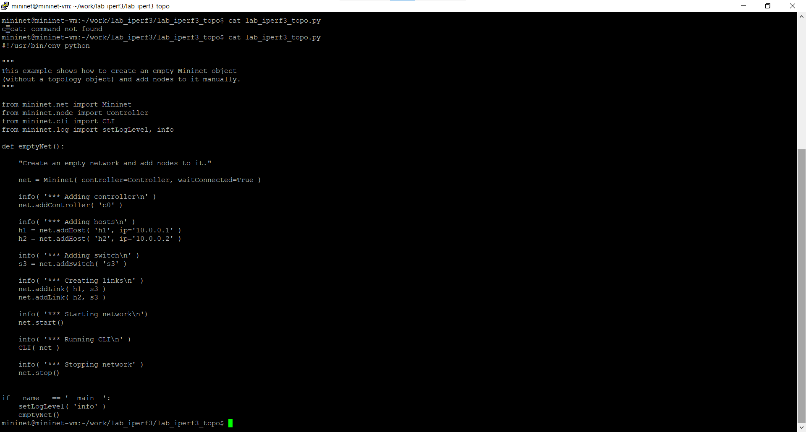

<!-- speaker-notes: В Python API Mininet вручную создаются контроллер c0, два хоста h1 и h2, коммутатор s3 и их соединения. -->

---

<!-- type: screenshot -->

# Запуск исходной топологии

<!-- speaker-notes: После запуска скрипта Mininet создал все узлы и открыл командную оболочку для проверки сети. -->

---

<!-- type: screenshot -->

# Проверка связности хостов

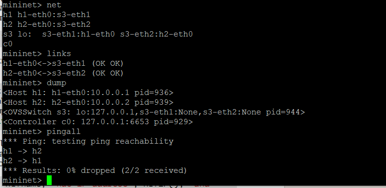

<!-- speaker-notes: Команды net, links и dump показывают состав сети; pingall подтвердил связность без потерь. -->

---

<!-- type: screenshot -->

# Получение адресных параметров h1

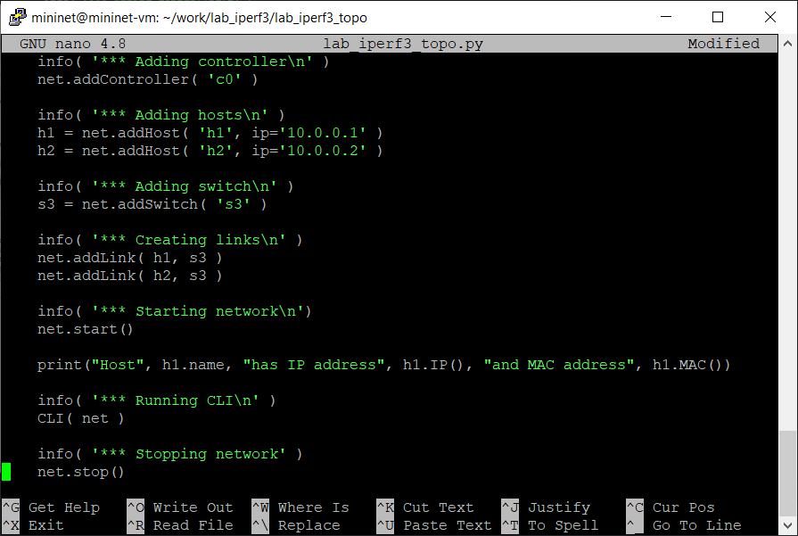

<!-- speaker-notes: В скрипт добавлена инструкция вывода IP- и MAC-адреса первого хоста. -->

---

<!-- type: screenshot -->

# Вывод IP- и MAC-адреса хоста h1

<!-- speaker-notes: Система вывела IP-адрес 10.0.0.1 и текущий MAC-адрес первого хоста. -->

---

<!-- type: screenshot -->

# Добавление вывода адресов h2

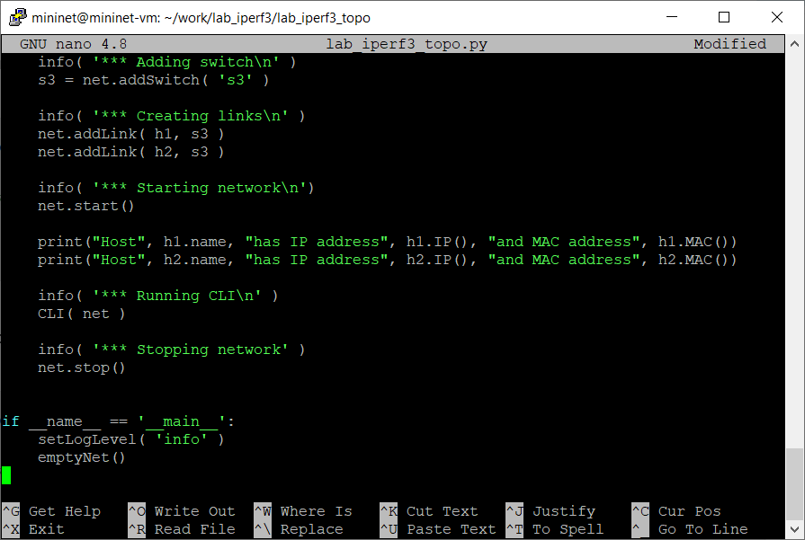

<!-- speaker-notes: Затем я добавил такой же вывод для второго хоста. -->

---

<!-- type: screenshot -->

# Получение адресов обоих хостов

<!-- speaker-notes: Адреса хостов — 10.0.0.1 и 10.0.0.2. MAC-адреса могут различаться при повторных запусках. -->

---

<!-- type: divider -->

# Моделирование ограничений

---

<!-- type: screenshot -->

# Импорт CPULimitedHost и TCLink

<!-- speaker-notes: Для ограничения ресурсов импортированы CPULimitedHost и TCLink. -->

---

<!-- type: screenshot -->

# Настройка ограничиваемых узлов и линий

<!-- speaker-notes: Теперь Mininet использует специальные классы хостов и каналов, поддерживающие программные ограничения. -->

---

<!-- type: screenshot -->

# Ограничение процессорных ресурсов

<!-- speaker-notes: Для h1 выставлен cpu=0.5, для h2 — cpu=0.45. -->

---

<!-- type: screenshot -->

# Настройка характеристик канала

<!-- speaker-notes: Для линии h1–s3 задано 10 Мбит/с, задержка 5 мс, вероятность потерь 10% и очередь 1000 пакетов. -->

---

<!-- type: screenshot -->

# Запуск сети с ограничениями

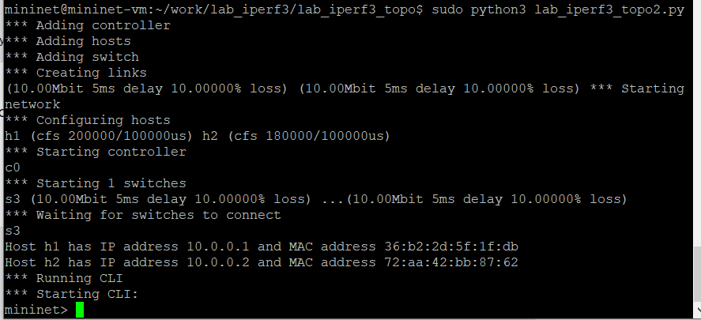

<!-- speaker-notes: При запуске эти ограничения отражаются в выводе Mininet. -->

---

<!-- type: screenshot -->

# Проверка параметров с помощью tc

<!-- speaker-notes: Команды Linux tc подтверждают, что HTB и netem применили заданные параметры. -->

---

<!-- type: divider -->

# Проверка работоспособности

---

<!-- type: screenshot -->

# ICMP-тест сети с ограничениями

<!-- speaker-notes: В ограниченной сети 20 пакетов отправлено, 17 получено, потери 15%, средний RTT 187.525 мс. -->

---

<!-- type: screenshot -->

# ICMP-тест исходной сети

<!-- speaker-notes: Без ограничений 20 запросов получили 20 ответов, потерь нет, средний RTT 0.176 мс. -->

---

<!-- type: divider -->

# Воспроизводимый эксперимент

---

<!-- type: screenshot -->

# Подготовка автоматизированного эксперимента

<!-- speaker-notes: Для следующего этапа создан отдельный каталог и выделен Python-скрипт автоматического теста. -->

---

<!-- type: screenshot -->

# Настройка Python-скрипта iPerf3

<!-- speaker-notes: Здесь используется Mininet с TCLink, но без ограничений долей CPU хостов. -->

---

<!-- type: screenshot -->

# Конфигурация каналов по 100 Мбит/с

<!-- speaker-notes: Оба канала настроены на 100 Мбит/с и 75 мс задержки, без заданных потерь. -->

---

<!-- type: screenshot -->

# Автоматический запуск сервера и клиента

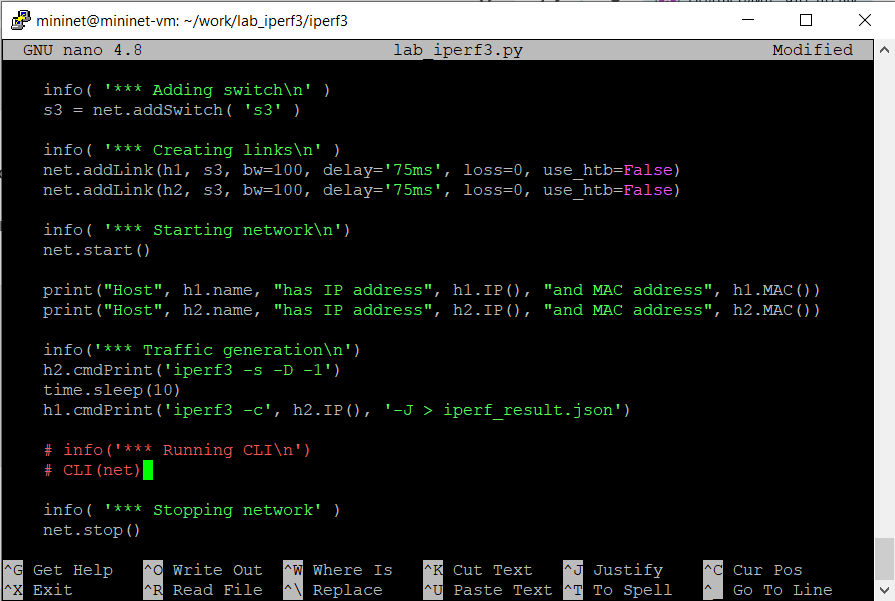

<!-- speaker-notes: После запуска сервера iPerf3 на h2 клиент с h1 сохраняет результат TCP-теста в JSON. -->

---

<!-- type: screenshot -->

# Выполнение TCP-эксперимента

<!-- speaker-notes: Эксперимент выполняется без интерактивной оболочки; программа создаёт и затем останавливает сеть. -->

---

<!-- type: screenshot -->

# Проверка результатов в JSON

<!-- speaker-notes: JSON прошёл синтаксическую проверку. В первом запуске получена скорость примерно 9.97 Мбит/с. -->

---

<!-- type: screenshot -->

# Построение графиков iPerf3

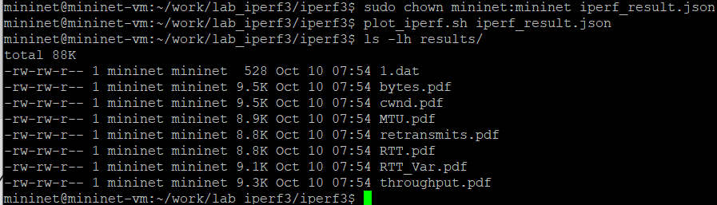

<!-- speaker-notes: Скрипт построил семь PDF-графиков с дополнительным файлом данных 1.dat. -->

---

<!-- type: divider -->

# Визуализация результатов

---

<!-- type: screenshot -->

# Изменение пропускной способности

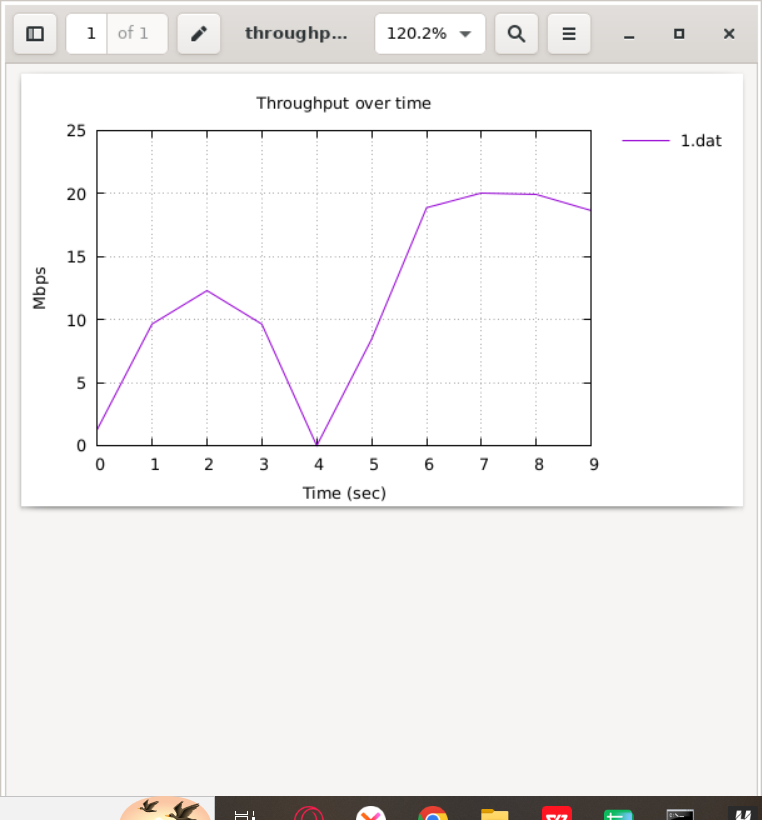

<!-- speaker-notes: Этот график отражает, как скорость менялась в течение десятисекундного теста. -->

---

<!-- type: screenshot -->

# Окно перегрузки TCP

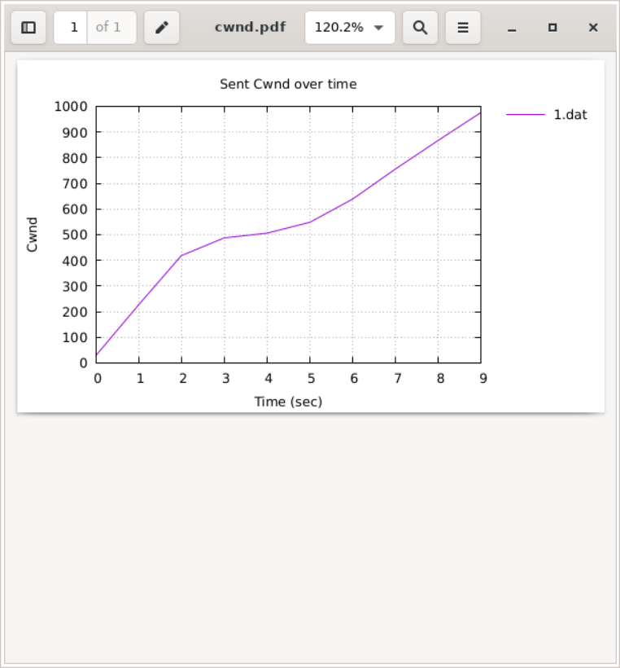

<!-- speaker-notes: Окно перегрузки TCP росло по мере передачи данных. -->

---

<!-- type: screenshot -->

# Время подтверждения TCP (RTT)

<!-- speaker-notes: На графике RTT видны колебания. Его числовую шкалу нельзя без проверки считать миллисекундами. -->

---

<!-- type: divider -->

# GNU Make и повторный запуск

---

<!-- type: screenshot -->

# Автоматизация с помощью Makefile

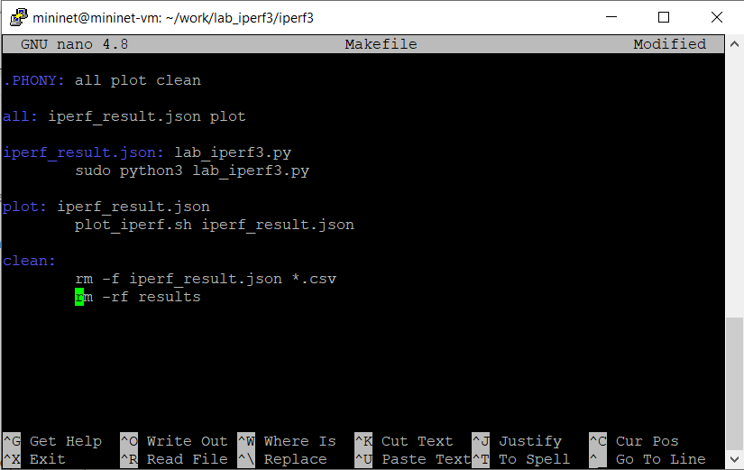

<!-- speaker-notes: В Makefile определены цели all, plot и clean для упрощения воспроизведения. -->

---

<!-- type: screenshot -->

# Повторный запуск эксперимента

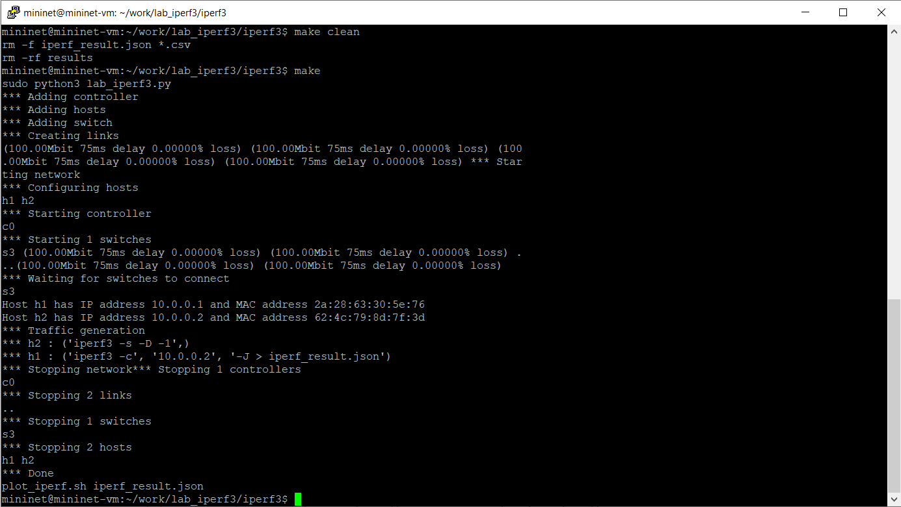

<!-- speaker-notes: Команды make clean и make заново запустили тест и сформировали результаты. -->

---

<!-- type: screenshot -->

# Проверка воспроизводимости результатов

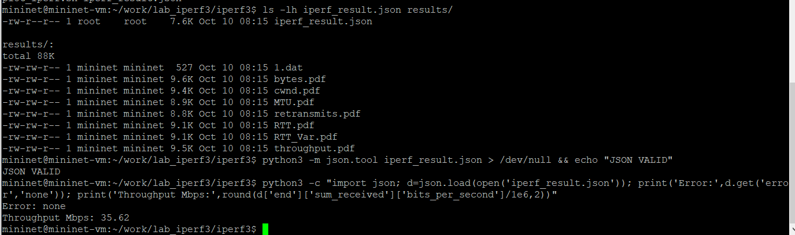

<!-- speaker-notes: Повторно получены корректный JSON и PDF. Скорость составила 35.62 Мбит/с — процедура воспроизводится, но измерения различаются. -->

---

<!-- type: divider -->

# Выводы

---

<!-- type: comparison -->

# Сопоставление результатов

## ICMP
- Обычная сеть: 0% потерь · RTT 0,176 мс
- Ограниченная сеть: 15% потерь · RTT 187,525 мс

## TCP / iPerf3
- Первый запуск: 9,97 Мбит/с
- Повторный запуск: 35,62 Мбит/с

Процедура запуска воспроизводима. Численные результаты различаются.

<!-- speaker-notes: В обычной сети пинг прошёл без потерь, в ограниченной — с потерями 15%. Скорости TCP в двух запусках различались. Поэтому повторяемость последовательности действий подтверждена, но стабильность численного результата требует дополнительных измерений. -->

---

<!-- type: bullets -->

# Итог лабораторной работы

- Построена топология Mininet через Python API
- Проверены сетевые адреса и связность хостов
- Смоделированы ограничения CPU, задержек и потерь
- Выполнены TCP-измерения iPerf3 и построены графики
- Проверен повторный автоматический запуск через GNU Make

<!-- speaker-notes: Главный результат — полностью автоматизированный рабочий эксперимент, который можно запустить повторно через make. -->
