# Отчёт по лабораторной работе № 3

**Измерение и тестирование пропускной способности сети. Воспроизводимый эксперимент**

**Дисциплина:** Моделирование сетей передачи данных  

**Автор:** Авдадаев Джамал Геланиевич  

**Группа:** НФИбд-02-23

**Дата выполнения:** 10 октября 2026 г.

## Содержание

- 1. Введение

- 1.1. Цель и задачи

- 1.2. Объект, предмет и термины

- 1.3. Теория и инструменты

- 2. Процесс выполнения

- 3. Полученные результаты и анализ

- 4. Заключение

- 5. Библиографическая информация

- 6. Перечень иллюстраций и таблиц

## 1. Введение

В лабораторной работе исследована работа небольшой виртуальной сети в Mininet и выполнены измерения с использованием iPerf3. Практическая часть последовательно охватывает исходную топологию, моделирование ограничений канала, автоматический TCP-тест, построение графиков и повторный запуск средствами GNU Make.

### 1.1. Цель и задачи

**Цель:** освоить Python API Mininet и организовать воспроизводимый эксперимент по измерению пропускной способности сети.

**Задачи:** создать топологию h1–s3–h2; проверить сетевую связность и адресацию; задать ограничения CPU и канала; сравнить ICMP-тесты; автоматизировать iPerf3 и экспорт JSON; построить графики; проверить команды make clean и make.

### 1.2. Объект, предмет и термины

**Объект исследования** — эмулируемая сеть с двумя хостами и одним коммутатором. **Предмет исследования** — настройки пропускной способности, задержек, потерь и измеренные показатели TCP/ICMP при повторном выполнении эксперимента.

**Обозначения:** Mininet — эмулятор сетей; iPerf3 — инструмент измерения сетевой производительности; RTT — время прохождения пакета туда и обратно; cwnd — окно перегрузки TCP; HTB — дисциплина обслуживания для ограничения скорости; netem — моделирование задержек и потерь; JSON — структурированный формат результатов.

### 1.3. Теория и инструменты

Среднеуровневый Python API Mininet позволяет вручную создавать узлы и соединения через addHost(), addSwitch(), addLink(), start() и stop(). TCLink задаёт параметры канала через Linux tc, CPULimitedHost ограничивает процессорное время. TCP-пропускная способность зависит не только от заданного значения bw, но также от RTT, cwnd и условий выполнения эксперимента.

Использованы Windows, VirtualBox, Mininet-VM (Ubuntu 20.04.1 LTS), SSH/PuTTY, Python 3, Mininet, iPerf3, ping, tc, GNU Make, Gnuplot и скрипты iperf3_plotter. В качестве метода проверки применены анализ вывода команд, ICMP-тесты, чтение JSON и визуальный анализ графиков. Для сохранения результатов использованы скриншоты этапов выполнения.

## 2. Процесс выполнения

### 2.1. Подготовка и исходная топология

Сначала подготовлен Python-скрипт на основе стандартного примера Mininet. Топология включает хосты h1 и h2, коммутатор s3, контроллер c0. Проверка связности выполнена до внесения ограничений.

В рабочем каталоге создана папка lab_iperf3_topo; исходный пример Mininet скопирован и переименован в lab_iperf3_topo.py.

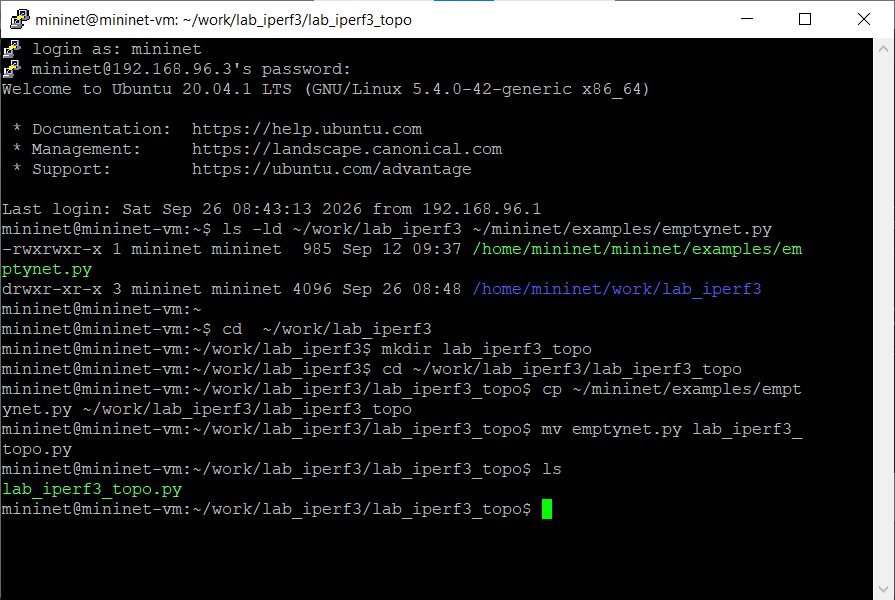

*Рис. 1: Подготовка рабочей папки и копирование emptynet.py.*

В шаблоне используются методы addController(), addHost(), addSwitch() и addLink(); с их помощью вручную формируется небольшая топология.

*Рис. 2: Исходный скрипт создания сети.*

Команда sudo python3 lab_iperf3_topo.py запускает контроллер c0, два хоста, коммутатор s3 и интерактивную оболочку Mininet.

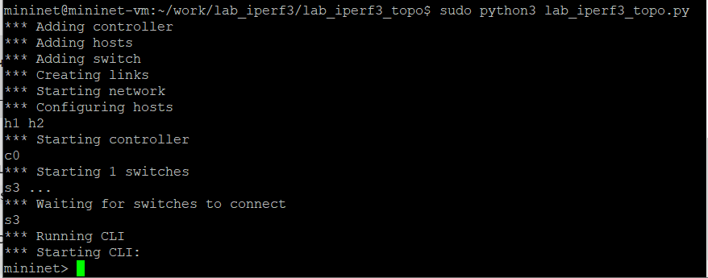

*Рис. 3: Запуск исходной топологии через Python API.*

Команды net, links и dump подтверждают состав топологии; pingall показывает 0% потерь при первичной проверке.

*Рис. 4: Проверка связности и состава сети.*

### 2.2. Получение IP- и MAC-адресов

После net.start() добавлен автоматический вывод сетевых параметров средствами Python API. Это удобно для проверки того, что созданные узлы получили ожидаемые IP-адреса.

В скрипт включена инструкция, использующая свойства name и методы IP() и MAC() объекта h1.

*Рис. 5: Добавление вывода параметров хоста h1.*

После запуска программа выводит IP-адрес 10.0.0.1 и назначенный хосту MAC-адрес.

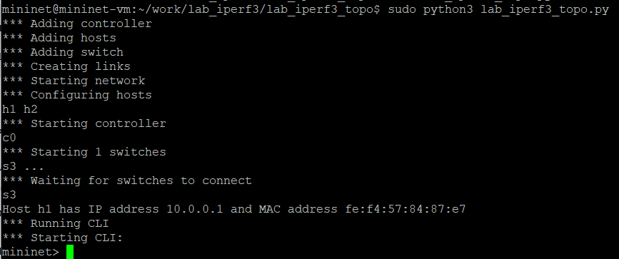

*Рис. 6: Вывод IP- и MAC-адреса h1.*

После строки для h1 добавлен аналогичный вывод имени, IP-адреса и MAC-адреса h2.

*Рис. 7: Добавление вывода параметров второго хоста.*

Выполнение кода подтверждает IP-адреса 10.0.0.1 и 10.0.0.2. MAC-адреса могут меняться при повторном создании сети.

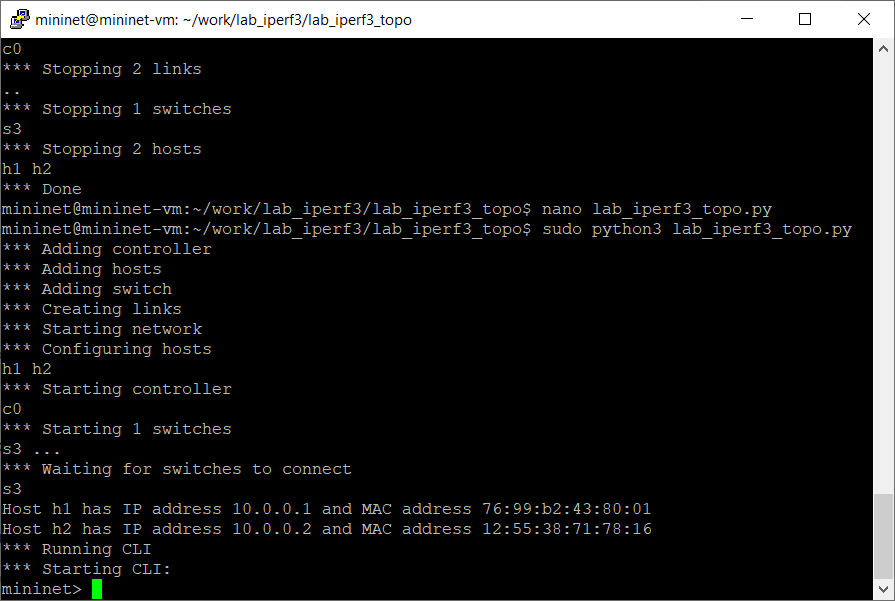

*Рис. 8: Результаты получения адресов обоих хостов.*

### 2.3. Моделирование ограниченного канала

Во второй версии скрипта подключены CPULimitedHost и TCLink. Ограничения скорости и потерь применены к линии h1–s3; их действие дополнительно подтверждено средствами Linux tc.

Для моделирования ограниченных ресурсов импортированы CPULimitedHost и TCLink.

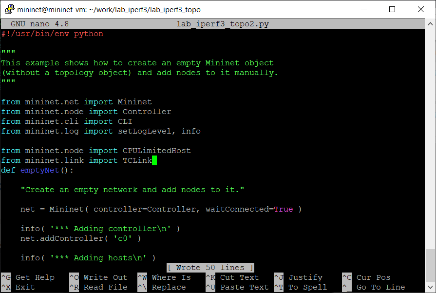

*Рис. 9: Подключение классов CPULimitedHost и TCLink.*

В конструктор Mininet добавлены параметры host=CPULimitedHost и link=TCLink.

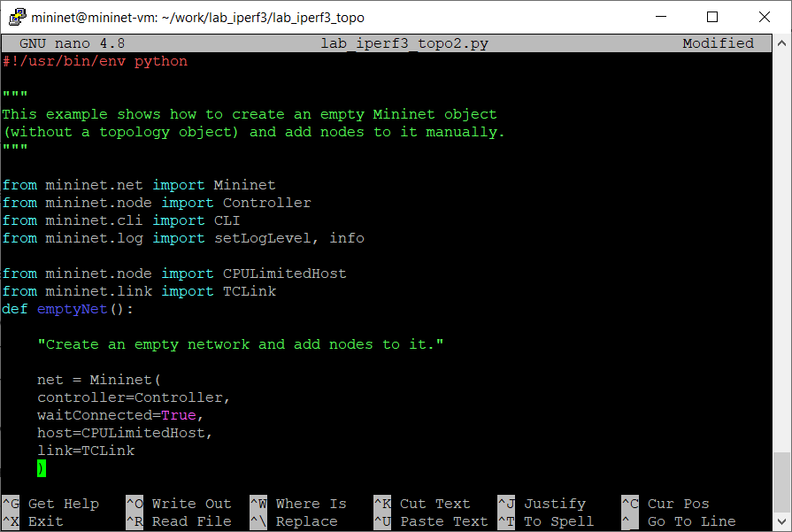

*Рис. 10: Настройка классов узлов и соединений Mininet.*

Для h1 указана доля cpu=0.5, для h2 — cpu=0.45; точная квота определяется Mininet с учётом числа доступных CPU.

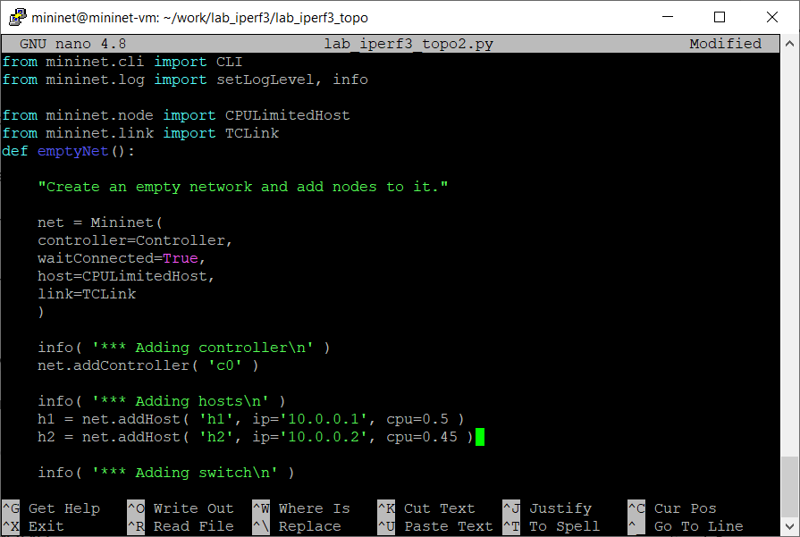

*Рис. 11: Назначение ограничений CPU хостам.*

Для линии h1–s3 задано bw=10, delay=5ms, loss=10, max_queue_size=1000 и use_htb=True.

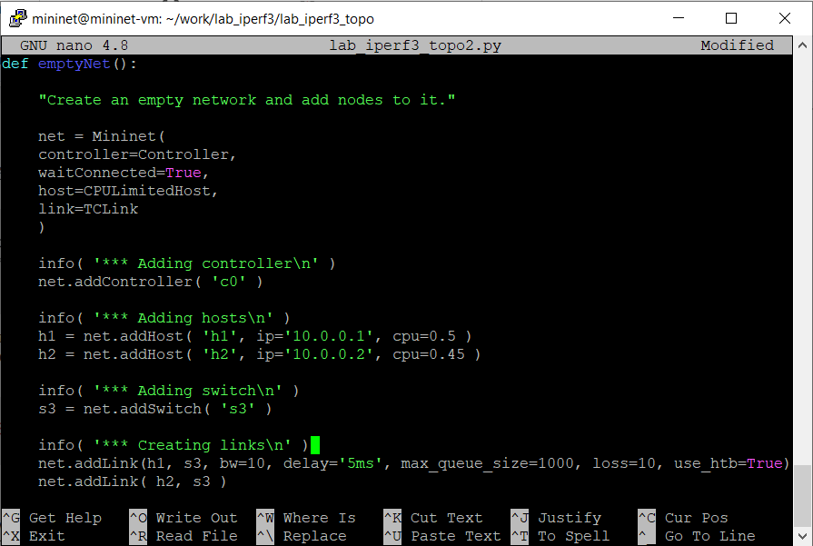

*Рис. 12: Настройка скорости, задержки и потерь канала.*

При запуске отображены параметры 10 Mbit, 5 ms и 10% потерь; конфигурация CPU применяется через CFS.

*Рис. 13: Запуск сети с заданными ограничениями.*

tc qdisc и tc class показывают ограничение до 10 Mbit, задержку 5 ms, 10% потерь и очередь 1000 пакетов.

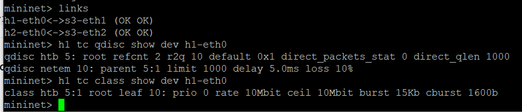

*Рис. 14: Проверка HTB и netem через tc.*

### 2.4. Сравнение качества передачи ICMP

Для ограниченной и обычной топологий проведены одинаковые серии по 20 ICMP-запросов. Условия и наблюдения сведены в сравнительную таблицу ниже.

| Показатель | Обычная сеть | Сеть с ограничениями |

|---|---:|---:|

| Отправлено / получено | 20 / 20 | 20 / 17 |

| Потери | 0% | 15% |

| Средний RTT | 0,176 мс | 187,525 мс |

| Минимальный RTT | 0,056 мс | 10,454 мс |

| Максимальный RTT | 1,518 мс | 1034,513 мс |

*Таблица 1 — Сравнение ICMP-измерений для двух топологий.*

Из 20 отправленных пакетов получено 17: потери 15%, средний RTT 187,525 мс.

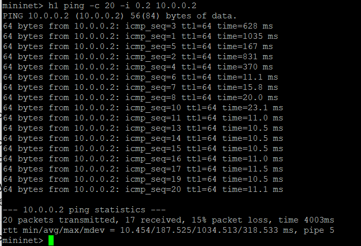

*Рис. 15: ICMP-измерения в ограниченной сети.*

При 20 запросах получено 20 ответов: потери 0%, средний RTT 0,176 мс.

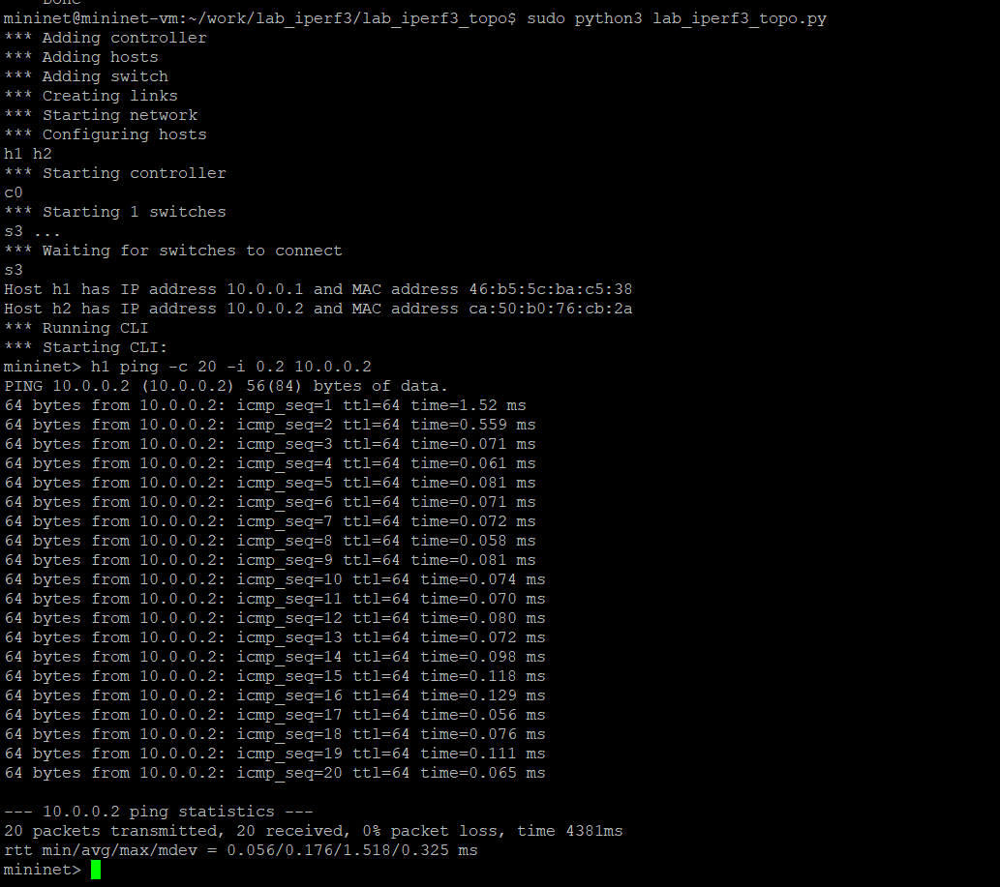

*Рис. 16: ICMP-измерения в сети без ограничений.*

При настройке loss=10 вероятность потери оценивается для прохождения пакета по ограниченной линии. Успешный ICMP-обмен требует прохождения запроса и ответа, поэтому 15% потерь за 20 запросов — возможный результат; для оценки вероятности нужны более длинные серии. Минимальное RTT в ограниченной сети согласуется примерно с 5 мс задержки на каждом направлении. Большие пики RTT нельзя уверенно объяснить без дополнительных данных.

### 2.5. Подготовка воспроизводимого эксперимента

Для автоматизации создан отдельный скрипт: два канала получают одинаковые параметры, а команда запуска iPerf3 формируется программно.

Для отдельного эксперимента создан каталог iperf3, куда перенесён скрипт lab_iperf3.py.

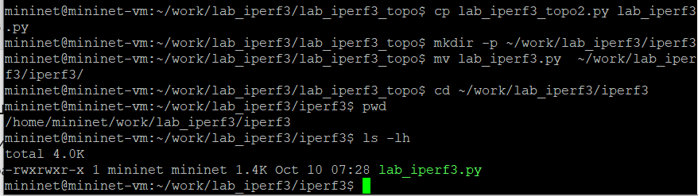

*Рис. 17: Создание каталога автоматизированного эксперимента.*

Подключена библиотека time, из Mininet убран CPULimitedHost; адреса хостов сохранены.

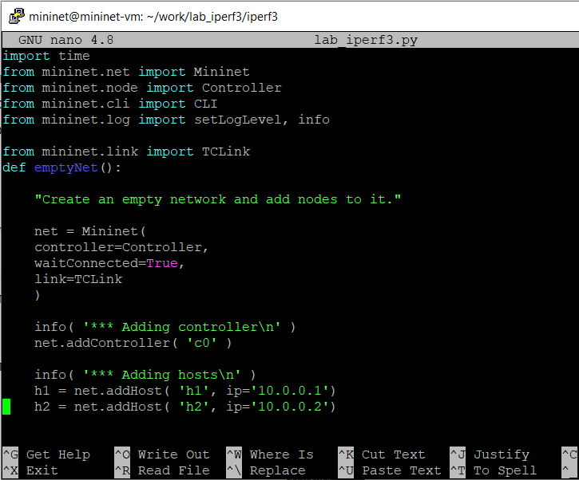

*Рис. 18: Подготовка скрипта без ограничений CPU.*

Для обоих соединений установлены bw=100, delay=75ms, loss=0 и use_htb=False.

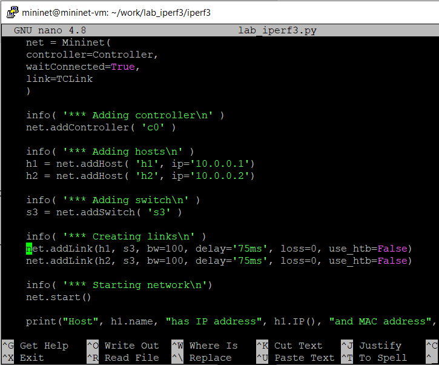

*Рис. 19: Настройка обоих каналов на 100 Мбит/с.*

Сервер запускается на h2 в режиме демона, через 10 секунд клиент h1 выполняет тест с ключом -J и сохраняет JSON.

*Рис. 20: Программный запуск iPerf3 и сохранение JSON.*

### 2.6. Автоматический запуск и обработка JSON

После запуска серверной части клиент выполняет десятисекундный TCP-тест. JSON проверяется синтаксически и содержит численное значение измеренной скорости.

Скрипт создал сеть, вызвал сервер и клиент iPerf3, затем завершил работу Mininet без входа в CLI.

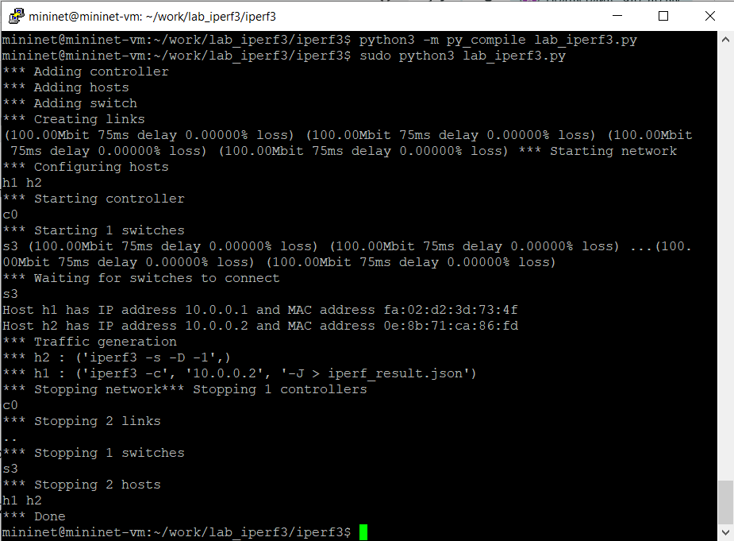

*Рис. 21: Выполнение автоматизированного эксперимента.*

Файл iperf_result.json прошёл проверку JSON VALID; ошибок iPerf3 нет, скорость получена около 9,97 Мбит/с.

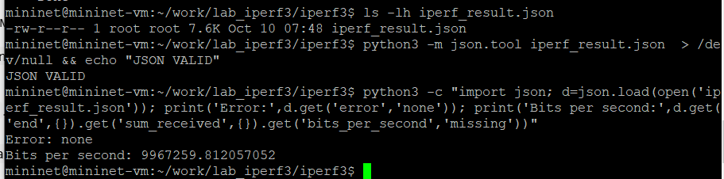

*Рис. 22: Проверка первого JSON-результата.*

Скрипт plot_iperf.sh построил семь PDF-графиков и вспомогательный набор данных 1.dat.

*Рис. 23: Генерация PDF-графиков.*

### 2.7. Визуализация результатов

Графики позволяют визуально сопоставить изменение пропускной способности, окна перегрузки TCP и времени получения подтверждений.

Кривая throughput показывает изменение скорости в течение 10-секундного TCP-теста; скорость заметно меняется со временем.

*Рис. 24: График пропускной способности.*

На графике cwnd виден рост значения окна перегрузки TCP в течение теста.

*Рис. 25: График окна перегрузки TCP.*

Кривая RTT отражает колебания времени подтверждения; исходная числовая шкала графика требует проверки единиц измерения.

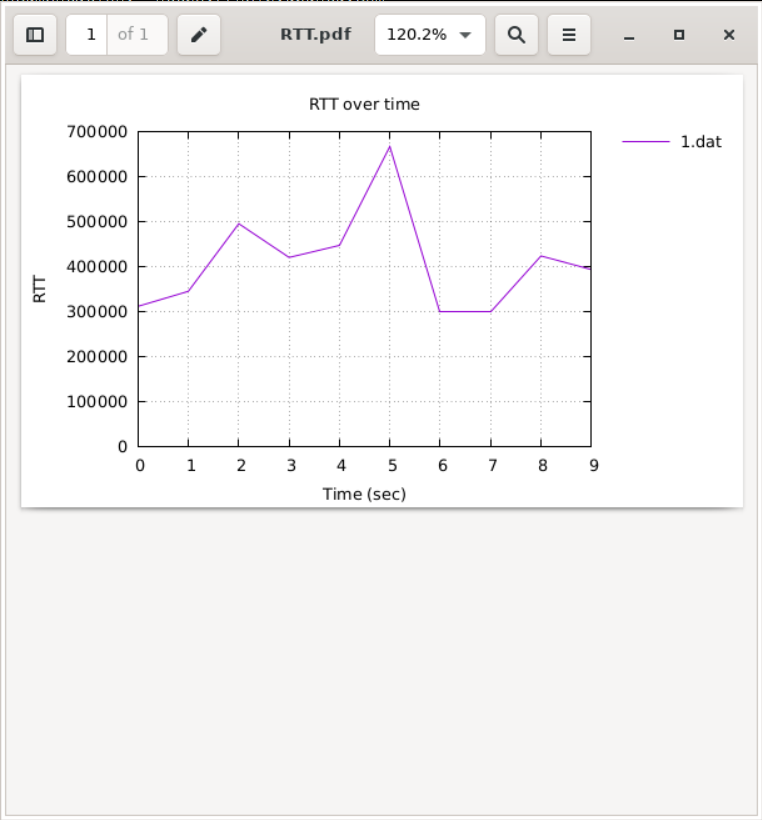

*Рис. 26: График RTT.*

Визуально график throughput отражает неравномерную скорость, а cwnd — рост окна перегрузки в ходе передачи. График RTT показывает изменения времени отклика; числовую шкалу нельзя без проверки единиц измерения трактовать как миллисекунды.

### 2.8. GNU Make и проверка воспроизводимости

После создания Makefile достаточно выполнить make clean и make. При повторном запуске скрипт заново сформировал результаты и графики без ручного запуска сети.

Makefile содержит цели all, iperf_result.json, plot и clean для повторяемой последовательности действий.

*Рис. 27: Правила автоматизации в Makefile.*

Команды make clean и make повторно создали сеть, вызвали iPerf3 и построили графики.

*Рис. 28: Повторный запуск после очистки результатов.*

После make снова созданы JSON и PDF; JSON VALID, Error: none, пропускная способность 35,62 Мбит/с.

*Рис. 29: Проверка итоговых файлов и результата.*

## 3. Полученные результаты и анализ

**Исходная топология:** связи h1–s3 и h2–s3 работали, pingall завершился без потерь. **Ограниченная топология:** настройки HTB/netem подтверждены tc; в коротком ICMP-тесте потери составили 15%, средний RTT — 187,525 мс, против 0% и 0,176 мс в сети без ограничений.

| Показатель | Первый автоматический запуск | Повторный запуск после make clean |

|---|---:|---:|

| Заданная скорость каждого канала | 100 Мбит/с | 100 Мбит/с |

| Заданная задержка каждого канала | 75 мс | 75 мс |

| Полученная TCP-скорость | 9,97 Мбит/с | 35,62 Мбит/с |

| Корректность JSON | JSON VALID | JSON VALID |

| Ошибка iPerf3 | отсутствует | отсутствует |

*Таблица 2 — Сопоставление автоматических TCP-экспериментов.*

Разница между измеренными скоростями составила 25,65 Мбит/с; во втором запуске скорость была приблизительно в 3,57 раза выше. Это подтверждает **воспроизводимость процедуры** (топология создаётся, тест запускается, JSON и графики формируются), но **не подтверждает стабильность численного результата**. Возможные причины различий — работа алгоритма TCP, его окно перегрузки, задержки, буферизация и состояние виртуальной машины; по двум измерениям выбрать одну доказанную причину нельзя.

Для статистической проверки повторяемости потребовалась бы серия независимых запусков с фиксированными условиями и сравнением скоростей, RTT, повторных передач и нагрузки на CPU. Дополнительная серия в рамках данной работы не выполнялась.

## 4. Заключение

Выполнены построение топологии Mininet через Python API, настройка хостов и каналов, проверка IP/MAC-адресов, ICMP-измерения и проверка HTB/netem. Автоматический эксперимент iPerf3 создал корректный JSON и семь PDF-графиков. Команды make clean и make повторно запустили полный цикл без ручного управления Mininet. При этом зафиксировано заметное различие TCP-скорости между двумя прогонами — важное ограничение численной повторяемости.

## 5. Библиографическая информация

1. Лабораторная работа № 3 «Измерение и тестирование пропускной способности сети. Воспроизводимый эксперимент». Учебно-методические материалы по дисциплине «Моделирование сетей передачи данных».

2. Mininet. Documentation and examples. https://mininet.org/

3. iPerf3. Documentation. https://software.es.net/iperf/

4. GNU Make Manual. https://www.gnu.org/software/make/manual/

5. ekfoury/iperf3_plotter. https://github.com/ekfoury/iperf3_plotter

## 6. Перечень иллюстраций и таблиц

- Рис. 1: Подготовка рабочей папки и копирование emptynet.py.

- Рис. 2: Исходный скрипт создания сети.

- Рис. 3: Запуск исходной топологии через Python API.

- Рис. 4: Проверка связности и состава сети.

- Рис. 5: Добавление вывода параметров хоста h1.

- Рис. 6: Вывод IP- и MAC-адреса h1.

- Рис. 7: Добавление вывода параметров второго хоста.

- Рис. 8: Результаты получения адресов обоих хостов.

- Рис. 9: Подключение классов CPULimitedHost и TCLink.

- Рис. 10: Настройка классов узлов и соединений Mininet.

- Рис. 11: Назначение ограничений CPU хостам.

- Рис. 12: Настройка скорости, задержки и потерь канала.

- Рис. 13: Запуск сети с заданными ограничениями.

- Рис. 14: Проверка HTB и netem через tc.

- Рис. 15: ICMP-измерения в ограниченной сети.

- Рис. 16: ICMP-измерения в сети без ограничений.

- Рис. 17: Создание каталога автоматизированного эксперимента.

- Рис. 18: Подготовка скрипта без ограничений CPU.

- Рис. 19: Настройка обоих каналов на 100 Мбит/с.

- Рис. 20: Программный запуск iPerf3 и сохранение JSON.

- Рис. 21: Выполнение автоматизированного эксперимента.

- Рис. 22: Проверка первого JSON-результата.

- Рис. 23: Генерация PDF-графиков.

- Рис. 24: График пропускной способности.

- Рис. 25: График окна перегрузки TCP.

- Рис. 26: График RTT.

- Рис. 27: Правила автоматизации в Makefile.

- Рис. 28: Повторный запуск после очистки результатов.

- Рис. 29: Проверка итоговых файлов и результата.

- Таблица 1 — Сравнение ICMP-измерений для двух топологий.

- Таблица 2 — Сопоставление автоматических TCP-экспериментов.
