---
## Author
author:
  name: Авдадаев Джамал Геланиевич
  email: 1032230169@rudn.ru
  affiliation:
    - name: Российский университет дружбы народов
      country: Российская Федерация
      postal-code: 117198
      city: Москва
      address: ул. Миклухо-Маклая, д. 6

## Title
title: "Отчёт по лабораторной работе №5"
subtitle: "Эмуляция и измерение потерь пакетов в глобальных сетях"
license: "CC BY"
---

# Цель работы

Основной целью работы является получение навыков проведения интерактивных экспериментов в среде Mininet по исследованию параметров сети, связанных с потерей, дублированием, изменением порядка и повреждением пакетов при передаче данных. Эти параметры влияют на производительность протоколов и сетей.

# Выполнение лабораторной работы

Для начала запускаю простейшую сетевую топологию Mininet, состоящую из двух хостов `h1` и `h2`, подключённых к одному коммутатору `s1`. Перед запуском проверяю параметры графического подключения с помощью команды `xauth list $DISPLAY`. Затем перехожу в режим суперпользователя командой `sudo -i` и добавляю соответствующий ключ авторизации X11 с помощью `xauth add`. Это необходимо для открытия графических терминалов сетевых устройств от имени пользователя `root`.

После настройки графического окружения выполняю команду `sudo mn --topo=single,2 -x`, где параметр `--topo=single,2` задаёт топологию с одним коммутатором и двумя хостами, а параметр `-x` обеспечивает открытие отдельных терминалов созданных устройств.

В процессе запуска Mininet создаёт контроллер `c0`, хосты `h1` и `h2`, коммутатор `s1`, а также соединения `(h1, s1)` и `(h2, s1)`. На экране появляются терминалы контроллера, коммутатора и обоих хостов. В основном терминале становится доступна интерактивная консоль `mininet>`, позволяющая управлять виртуальной сетью. Успешное открытие дополнительных терминалов подтверждает правильность настройки графического подключения (см. рис. [@fig-001]).

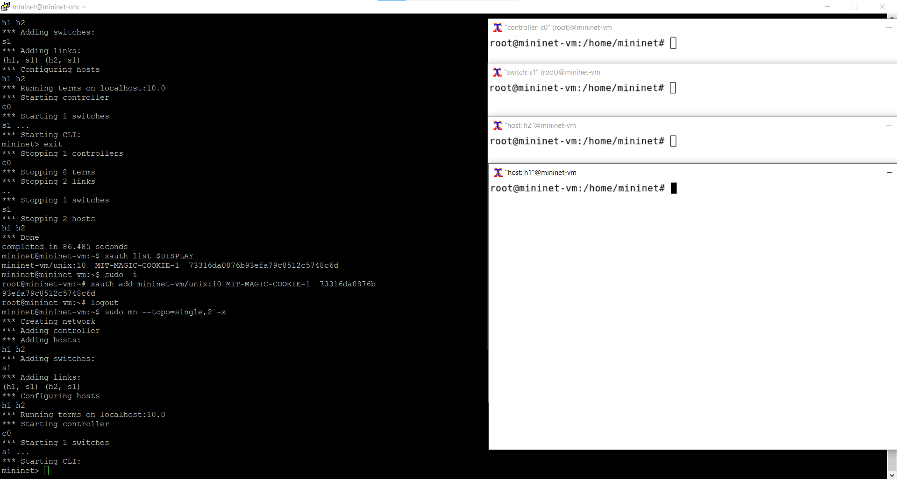{ #fig-001 width=70% }

После запуска топологии проверяю конфигурацию сетевых интерфейсов. Для этого в терминалах хостов `h1` и `h2` выполняю команду `ifconfig`, которая отображает параметры сетевых интерфейсов, назначенные IP-адреса и статистику передачи данных.

В результате получаю информацию об интерфейсе `h1-eth0`, которому назначен IP-адрес `10.0.0.1` с маской подсети `255.0.0.0`. Второму хосту на интерфейсе `h2-eth0` назначен IP-адрес `10.0.0.2` с аналогичной маской. Оба адреса принадлежат сети `10.0.0.0/8`, используемой Mininet по умолчанию.

Интерфейсы находятся в состоянии `UP`, `RUNNING` и поддерживают передачу пакетов с MTU, равным `1500` байт. Дополнительно на каждом хосте присутствует интерфейс обратной петли `lo` с адресом `127.0.0.1`.

В дальнейшем интерфейсы `h1-eth0` и `h2-eth0` используются для применения правил NETEM, позволяющих управлять потерей, повреждением, задержкой, переупорядочиванием и дублированием пакетов (см. рис. [@fig-002]).

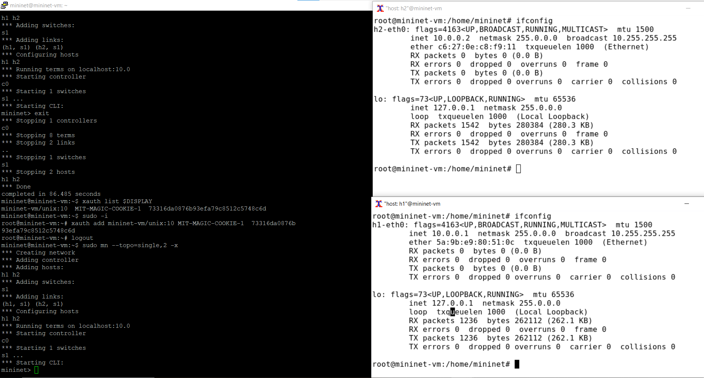{ #fig-002 width=70% }

Далее проверяю доступность второго хоста и измеряю исходное время передачи пакетов без дополнительных ограничений. Для этого в терминале хоста `h1` выполняю команду `ping -c 6 10.0.0.2`, которая отправляет шесть ICMP-запросов к хосту `h2`.

В результате все шесть отправленных пакетов успешно достигают получателя, потери составляют `0%`. Время ответа первого пакета равно приблизительно `1.72 мс`, тогда как последующие запросы обрабатываются значительно быстрее, преимущественно менее `0.3 мс`.

По итогам проверки получаю следующие показатели RTT:

- минимальное время — `0.070 мс`;
- среднее время — `0.385 мс`;
- максимальное время — `1.716 мс`;
- стандартное отклонение — `0.598 мс`.

Полученные результаты показывают, что в исходной виртуальной сети задержка передачи пакетов минимальна. Более высокое время ответа первого пакета может быть связано с первоначальной обработкой сетевого обмена, включая разрешение адресов и инициализацию сетевых механизмов.

Данные показатели использую в качестве исходных значений для дальнейшего сравнения с результатами экспериментов NETEM (см. рис. [@fig-003]).

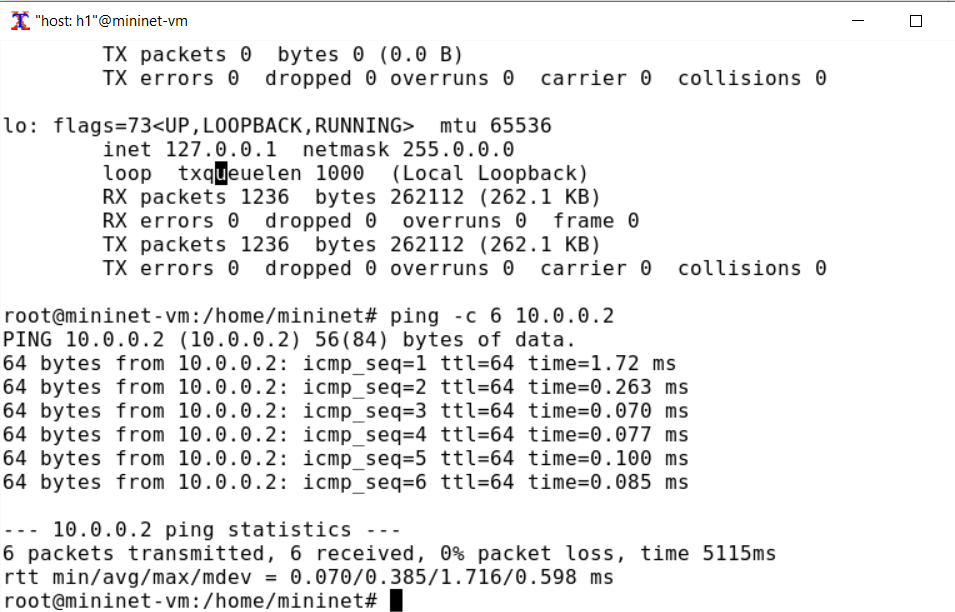{ #fig-003 width=70% }

После проверки исходного состояния сети перехожу к исследованию потерь пакетов. Для этого на интерфейсе `h1-eth0` задаю вероятность потери пакетов `10%` с помощью команды `sudo tc qdisc add dev h1-eth0 root netem loss 10%`.

В данной команде `tc` используется для управления сетевым трафиком Linux, `qdisc` обозначает дисциплину очередей, `add` добавляет новое правило, `dev h1-eth0` определяет сетевой интерфейс, `root` указывает на корневую дисциплину очередей, а `netem loss 10%` задаёт вероятность отбрасывания исходящих пакетов, равную `10%`.

Для проверки применённого ограничения выполняю команду `ping -c 100 10.0.0.2`, отправляющую сто ICMP-запросов от хоста `h1` к хосту `h2`.

В результате из `100` отправленных пакетов успешно получен `91` пакет. Потеряны `9` пакетов, что соответствует `9%` от общего количества отправленных запросов. В отображаемой части результатов отсутствуют, в частности, ответы с номерами `icmp_seq=95` и `icmp_seq=97`, что подтверждает пропуск отдельных пакетов.

Значения RTT составляют:

- минимальное время — `0.043 мс`;
- среднее время — `0.107 мс`;
- максимальное время — `0.918 мс`;
- стандартное отклонение — `0.118 мс`.

Измеренное значение потерь `9%` близко к заданному уровню `10%`. Небольшое расхождение объясняется вероятностным характером работы NETEM и ограниченным количеством отправленных пакетов (см. рис. [@fig-004]).

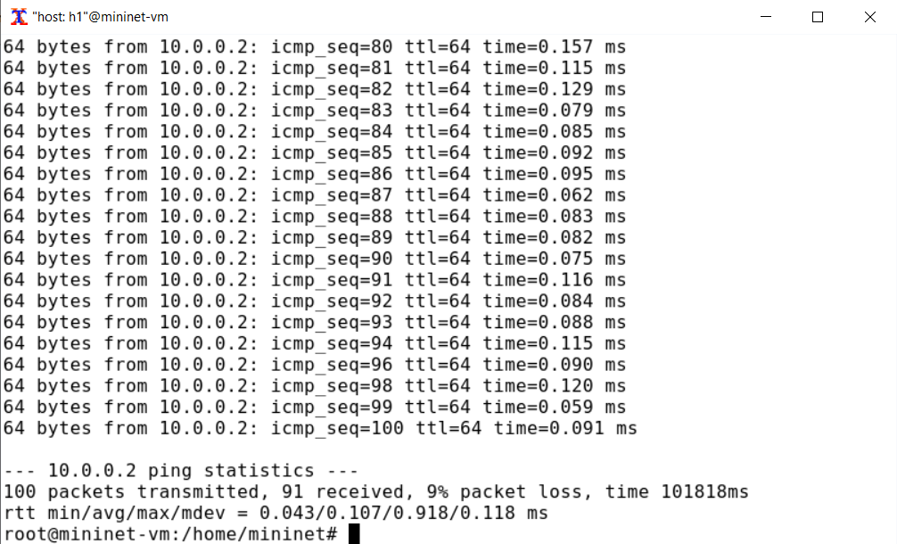{ #fig-004 width=70% }

Далее исследую потери пакетов при передаче данных в обоих направлениях. Для этого дополнительно применяю правило `sudo tc qdisc add dev h2-eth0 root netem loss 10%` к интерфейсу второго хоста.

В результате вероятность потери пакетов `10%` устанавливается как для исходящего трафика хоста `h1`, так и для исходящего трафика хоста `h2`. При использовании ICMP-запросов потери могут происходить как при отправке запроса, так и при возвращении ответного пакета.

Повторно выполняю команду `ping -c 100 10.0.0.2` с хоста `h1`. В полученном выводе наблюдаю пропуски последовательных номеров `icmp_seq`. В отображаемом фрагменте отсутствуют ответы с номерами `81`, `92`, `94` и `100`.

По итогам эксперимента получаю следующие результаты:

- отправлено пакетов — `100`;
- получено пакетов — `84`;
- потеряно пакетов — `16`;
- процент потерь — `16%`.

Показатели RTT составляют `0.054/0.127/1.631/0.196 мс` для минимального, среднего, максимального времени и стандартного отклонения соответственно.

По сравнению с предыдущим экспериментом процент потерь увеличивается с `9%` до `16%`. Полученный результат объясняется действием ограничений в обоих направлениях передачи данных. При этом фактическое количество потерянных пакетов определяется вероятностной моделью NETEM (см. рис. [@fig-005]).

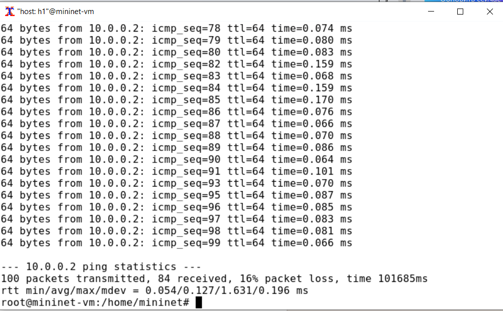{ #fig-005 width=70% }

После завершения эксперимента восстанавливаю исходную конфигурацию сетевых интерфейсов. Для удаления ранее установленных правил NETEM использую команды `sudo tc qdisc del dev h1-eth0 root netem` и `sudo tc qdisc del dev h2-eth0 root netem`.

Удаление корневых дисциплин NETEM позволяет вернуть стандартную обработку сетевого трафика без искусственно заданных потерь.

Для проверки соединения выполняю команду `ping 10.0.0.2` с хоста `h1`. После получения нескольких ответов останавливаю проверку сочетанием клавиш `Ctrl+C`.

В результате отправлено `17` пакетов, все `17` ответов успешно получены. Процент потерь составляет `0%`.

Дополнительно получаю следующие показатели RTT:

- минимальное время — `0.057 мс`;
- среднее время — `0.175 мс`;
- максимальное время — `0.811 мс`;
- стандартное отклонение — `0.205 мс`.

Отсутствие потерь подтверждает восстановление нормальной передачи ICMP-пакетов между хостами после удаления правил NETEM (см. рис. [@fig-006]).

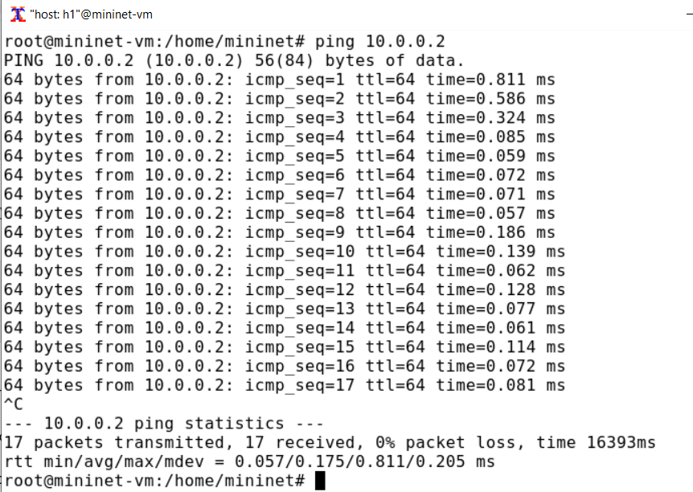{ #fig-006 width=70% }

Следующим этапом исследую потери пакетов с использованием коэффициента корреляции. Для этого на интерфейсе `h1-eth0` применяю команду `sudo tc qdisc add dev h1-eth0 root netem loss 50% 50%`.

Первое значение `50%` задаёт уровень потерь пакетов, а второе значение `50%` определяет коэффициент корреляции между последовательными событиями потери. Корреляция позволяет моделировать ситуации, при которых вероятность потери очередного пакета зависит от предыдущего состояния передачи.

Для проверки выполняю команду `ping -c 50 10.0.0.2`, отправляющую пятьдесят ICMP-запросов.

В результатах наблюдаю значительные пропуски номеров последовательности. Например, после ответа с номером `icmp_seq=12` следующим полученным ответом становится `icmp_seq=26`. Это означает отсутствие ответов для пакетов с номерами от `13` до `25` включительно.

По итогам измерения получаю следующие значения:

- отправлено пакетов — `50`;
- получено пакетов — `22`;
- потеряно пакетов — `28`;
- процент потерь — `56%`;
- минимальное RTT — `0.057 мс`;
- среднее RTT — `0.184 мс`;
- максимальное RTT — `1.058 мс`;
- стандартное отклонение RTT — `0.251 мс`.

Полученные результаты подтверждают значительное увеличение потерь и появление последовательностей отсутствующих ответов. Фактический процент потерь `56%` отличается от заданных `50%` вследствие вероятностного характера эмуляции (см. рис. [@fig-007]).

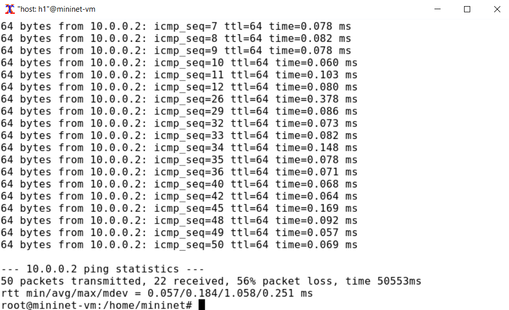{ #fig-007 width=70% }

Далее перехожу к исследованию повреждения пакетов при передаче данных. Предварительно удаляю ранее установленное правило командой `sudo tc qdisc del dev h1-eth0 root netem`.

После восстановления интерфейса добавляю правило `sudo tc qdisc add dev h1-eth0 root netem corrupt 0.01%`, задающее вероятность повреждения пакетов `0.01%`.

Параметр `corrupt` предназначен для искусственного изменения содержимого передаваемых пакетов. Повреждение может приводить к ошибкам контрольных сумм, отбрасыванию сегментов и необходимости их повторной передачи протоколом TCP.

Для исследования влияния повреждений использую инструмент `iPerf3`. На хосте `h2` запускаю сервер командой `iperf3 -s`, а на хосте `h1` выполняю подключение к нему командой `iperf3 -c 10.0.0.2`.

В результате устанавливается TCP-соединение с сервером по порту `5201`, после чего запускается измерение производительности сети продолжительностью `10` секунд.

В выводе iPerf3 анализирую столбец `Retr`, отображающий количество повторных передач TCP-сегментов на каждом временном интервале. Получаю следующие значения:

- `0–1 с` — `4` повторные передачи;
- `1–2 с` — `2`;
- `2–3 с` — `7`;
- `3–4 с` — `5`;
- `4–5 с` — `8`;
- `5–6 с` — `3`;
- `6–7 с` — `9`;
- `7–8 с` — `7`;
- `8–9 с` — `7`;
- `9–10 с` — `3`.

Общее количество повторных передач составляет `55`. За время эксперимента передано `21.8 GBytes` данных, а средняя пропускная способность составляет `18.7 Gbit/s`.

Наличие повторных передач показывает, что при работе TCP возникают ситуации, требующие повторной отправки сегментов. Полученные значения согласуются с воздействием настроенного повреждения пакетов на передачу данных (см. рис. [@fig-008]).

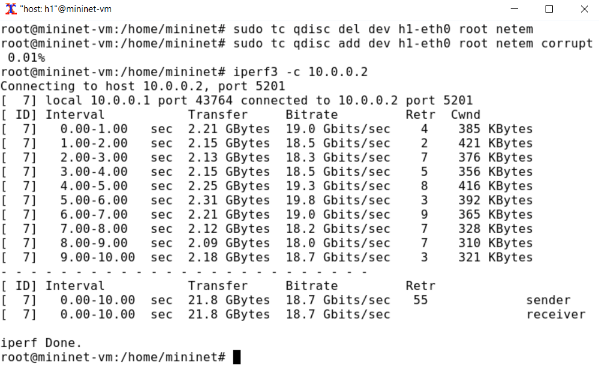{ #fig-008 width=70% }

После завершения проверки повреждения пакетов удаляю действующее правило NETEM командой `sudo tc qdisc del dev h1-eth0 root netem`.

Далее перехожу к исследованию изменения порядка передачи пакетов. Для этого выполняю команду `sudo tc qdisc add dev h1-eth0 root netem delay 10ms reorder 25% 50%`.

В данной команде параметр `delay 10ms` задаёт задержку передачи пакетов `10 мс`, параметр `reorder 25%` определяет вероятность изменения порядка передачи, а значение `50%` задаёт корреляцию. При использовании данного правила часть пакетов передаётся без дополнительной задержки, а остальные подвергаются задержке около `10 мс`.

Для проверки выполняю команду `ping -c 20 10.0.0.2`, отправляющую двадцать ICMP-запросов.

В полученных результатах наблюдаю две группы значений времени ответа. Для большинства пакетов RTT составляет приблизительно `10–12 мс`, тогда как отдельные пакеты имеют значительно меньшее время ответа.

Например, для пакета `icmp_seq=14` время ответа составляет `0.082 мс`, а для пакета `icmp_seq=17` — `0.085 мс`. При этом для соседних пакетов значения RTT находятся преимущественно около `10 мс`.

По итогам проверки получаю следующие показатели:

- отправлено пакетов — `20`;
- получено пакетов — `20`;
- процент потерь — `0%`;
- минимальное RTT — `0.082 мс`;
- среднее RTT — `9.497 мс`;
- максимальное RTT — `12.309 мс`;
- стандартное отклонение RTT — `3.193 мс`.

Полученные результаты подтверждают действие механизма изменения задержки передачи пакетов. При этом последовательность ICMP-ответов не содержит пропусков, а непосредственно подтвердить изменение порядка доставки по одному выводу `ping` нельзя. Различие значений RTT показывает влияние настроенной дисциплины NETEM на обработку исходящего трафика (см. рис. [@fig-009]).

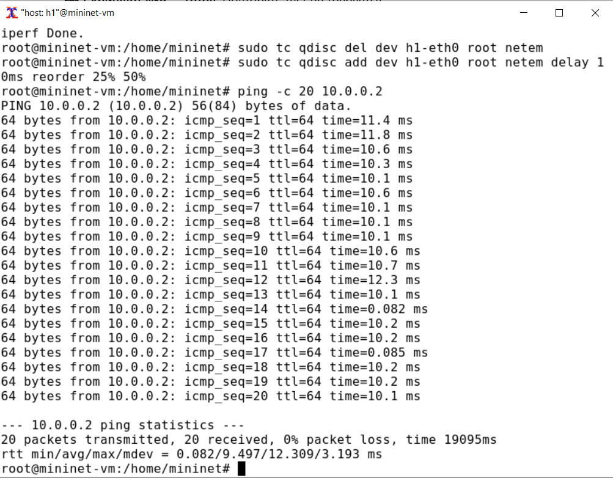{ #fig-009 width=70% }

Следующим этапом исследую дублирование пакетов. Для этого после удаления предыдущего правила задаю на интерфейсе `h1-eth0` команду `sudo tc qdisc add dev h1-eth0 root netem duplicate 50%`.

Параметр `duplicate 50%` устанавливает вероятность создания дополнительной копии передаваемого пакета, равную `50%`. В результате один исходящий пакет может быть передан получателю более одного раза.

Для проверки выполняю команду `ping -c 20 10.0.0.2`. В выводе терминала наблюдаю появление повторных ICMP-ответов, обозначенных меткой `DUP!`.

Например, дублированные ответы появляются для пакетов с номерами `icmp_seq=3`, `icmp_seq=6`, `icmp_seq=9`, `icmp_seq=10`, `icmp_seq=12`, `icmp_seq=13`, `icmp_seq=18` и `icmp_seq=19`.

По итогам эксперимента получаю следующие результаты:

- отправлено ICMP-запросов — `20`;
- получено основных ответов — `20`;
- дополнительных дубликатов — `8`;
- процент потерь — `0%`.

Доля запросов, для которых наблюдаются дубликаты, составляет `40%`, что близко к настроенной вероятности `50%` с учётом небольшого количества запросов.

Показатели RTT составляют `0.060/0.190/1.605/0.314 мс` для минимального, среднего, максимального времени и стандартного отклонения соответственно.

Полученные результаты подтверждают возможность искусственного дублирования пакетов средствами NETEM. При этом дублирование не приводит к потере исходных ICMP-ответов, что подтверждается значением `0% packet loss` (см. рис. [@fig-010]).

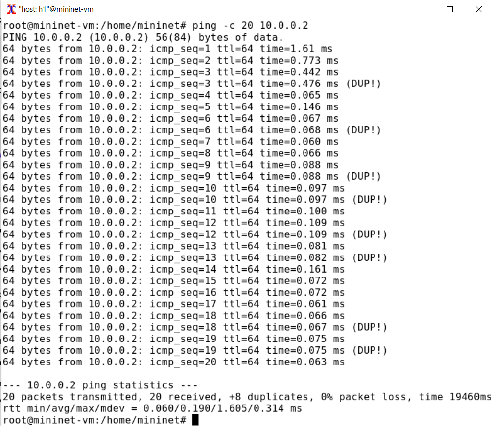{ #fig-010 width=70% }

После завершения интерактивных экспериментов перехожу к реализации воспроизводимых сценариев с использованием программного интерфейса Mininet API. Это позволяет автоматизировать создание виртуальной сети, настройку сетевых ограничений, выполнение измерений и сохранение результатов.

Для первого эксперимента создаю рабочий каталог `~/work/lab_netem_ii/simple-drop`, предназначенный для исследования потерь пакетов в обоих направлениях передачи данных.

В созданном каталоге открываю текстовый редактор `nano` и начинаю подготовку Python-скрипта `lab_netem_ii.py`. В начале файла указываю интерпретатор `#!/usr/bin/env python` и подключаю необходимые библиотеки.

Использую модуль `mininet.net` для создания виртуальной сети, `mininet.node` для управления контроллером, `mininet.cli` для работы с интерфейсом Mininet и `mininet.log` для вывода диагностической информации. Дополнительно импортирую модуль `time`, необходимый для организации временных пауз.

В скрипте определяю функцию `emptyNet()`, внутри которой создаю экземпляр Mininet с параметрами `controller=Controller` и `waitConnected=True`. Данные параметры позволяют использовать стандартный контроллер Mininet и ожидать установления соединения с коммутатором перед дальнейшим выполнением эксперимента (см. рис. [@fig-011]).

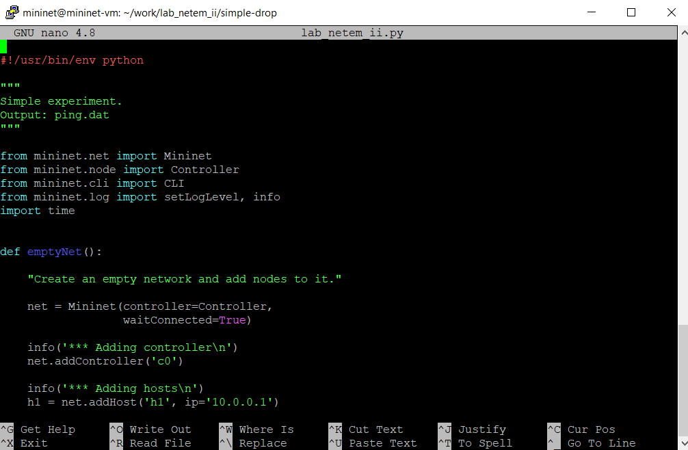{ #fig-011 width=70% }

Далее реализую основную логику создания сетевой топологии. Внутри функции `emptyNet()` добавляю контроллер `c0`, два хоста `h1` и `h2` с IP-адресами `10.0.0.1` и `10.0.0.2`, а также коммутатор `s1`.

Для создания соединений использую методы `net.addLink(h1, s1)` и `net.addLink(h2, s1)`. После определения всех компонентов запускаю виртуальную сеть методом `net.start()`.

Для настройки потерь пакетов применяю методы `h1.cmdPrint()` и `h2.cmdPrint()`, позволяющие выполнять системные команды непосредственно в пространстве имён соответствующих хостов.

На интерфейсах обоих хостов устанавливаю правила `tc qdisc add dev h1-eth0 root netem loss 10%` и `tc qdisc add dev h2-eth0 root netem loss 10%`.

После установки ограничений вызываю `time.sleep(10)`, создающий паузу продолжительностью десять секунд перед началом измерений.

Для проверки соединения запускаю команду `ping -c 100` с хоста `h1` по адресу второго хоста. Вывод команды передаю через утилиту `tee` в файл `ping_full.dat`, предназначенный для хранения полного результата проверки.

Далее с помощью `grep`, `awk` и `sed` выделяю сведения о номерах успешно полученных ответов `icmp_seq` и значениях времени `time`. Обработанные результаты сохраняю в файл `ping.dat`.

Для отображения итоговой статистики использую команду `tail -n 3 ping_full.dat`, которая выводит последние три строки полного отчёта `ping`, включая количество отправленных и полученных пакетов, процент потерь и показатели RTT.

По завершении измерений останавливаю виртуальную сеть вызовом `net.stop()`. Это обеспечивает освобождение созданных сетевых ресурсов и завершение работы экспериментальной топологии (см. рис. [@fig-012]).

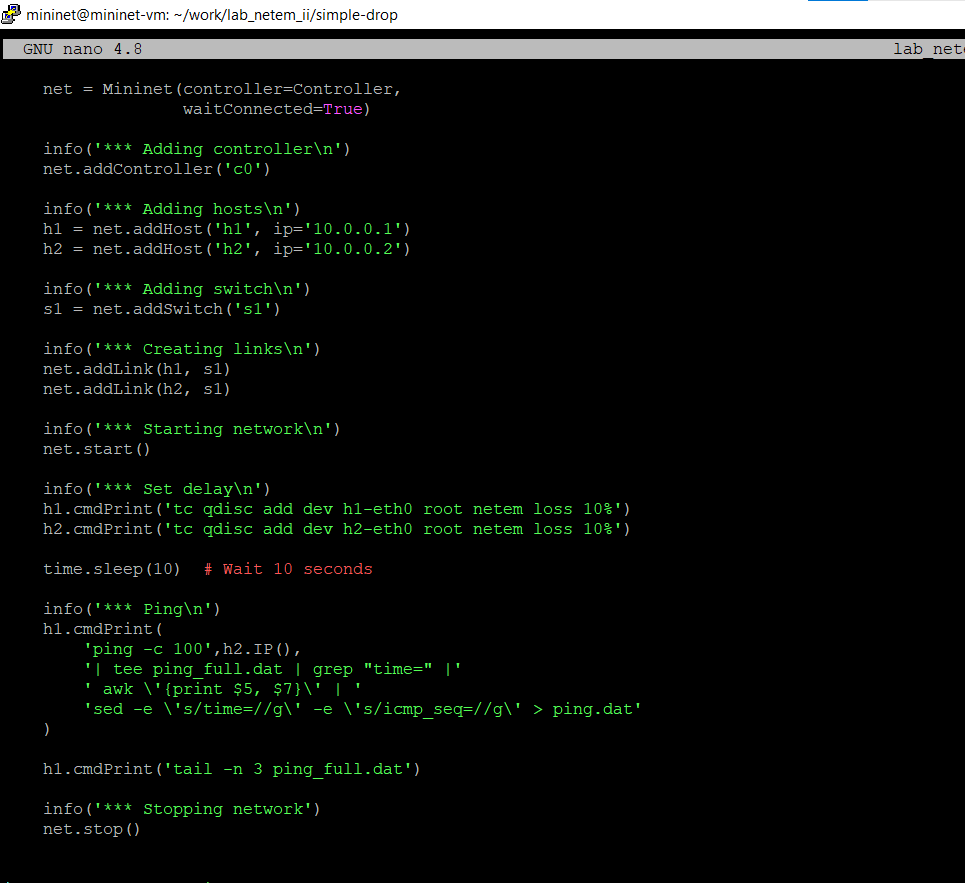{ #fig-012 width=70% }

Для автоматизации запуска подготовленного Python-скрипта создаю файл `Makefile` в каталоге `simple-drop`.

В файле задаю основную цель `all: ping.dat`, указывающую, что результатом выполнения эксперимента должен стать файл `ping.dat`.

Для формирования файла результата определяю цель `ping.dat`, внутри которой выполняется команда `sudo python lab_netem_ii.py`. Запуск с повышенными привилегиями необходим для создания виртуальных сетевых интерфейсов, коммутатора и изменения дисциплин очередей.

После завершения программы использую команду `sudo chown mininet:mininet ping.dat`, изменяющую владельца результирующего файла на пользователя `mininet`.

Дополнительно предусматриваю цель `clean`, использующую команду `-rm -f *.dat` для удаления файлов результатов. Начальный символ `-` позволяет продолжить выполнение Makefile даже в случае ошибки команды удаления.

Созданный Makefile позволяет выполнять эксперимент командой `make`, а при необходимости удалять результаты предыдущих запусков командой `make clean` (см. рис. [@fig-013]).

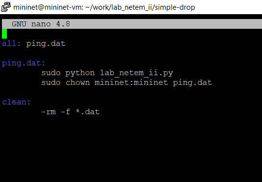{ #fig-013 width=70% }

После подготовки Python-скрипта и Makefile запускаю первый воспроизводимый эксперимент командой `make`.

При выполнении данной команды автоматически запускается `lab_netem_ii.py`, создаётся контроллер `c0`, добавляются хосты `h1` и `h2`, формируется коммутатор `s1` и устанавливаются соединения между компонентами топологии.

После запуска сети скрипт применяет к обоим интерфейсам ограничения NETEM с вероятностью потери пакетов `10%`. Затем выполняется проверка доступности второго хоста с отправкой ста ICMP-запросов.

В результате эксперимент завершается успешно. В итоговом отчёте получаю следующие значения:

- отправлено пакетов — `100`;
- получено пакетов — `77`;
- потеряно пакетов — `23`;
- процент потерь — `23%`;
- минимальное RTT — `0.063 мс`;
- среднее RTT — `0.122 мс`;
- максимальное RTT — `2.095 мс`;
- стандартное отклонение RTT — `0.232 мс`.

Полученный процент потерь `23%` отражает одновременное воздействие ограничений на исходящие пакеты обоих хостов. При этом результат отличается от интерактивного эксперимента, в котором при аналогичных настройках было зафиксировано `16%` потерь.

Это связано с вероятностным механизмом NETEM, при котором количество фактически потерянных пакетов может изменяться при каждом запуске.

После завершения проверки скрипт автоматически останавливает сеть, удаляет виртуальные соединения и завершает работу контроллера. В консоли отображается сообщение `*** Done`, подтверждающее корректное завершение эксперимента (см. рис. [@fig-014]).

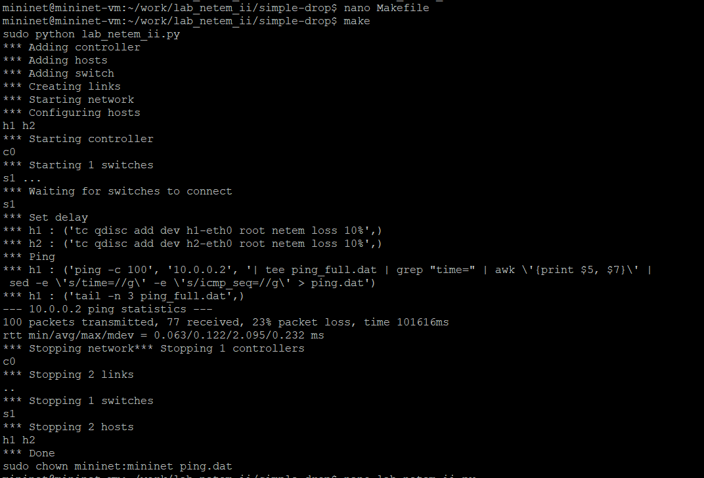{ #fig-014 width=70% }

Далее реализую воспроизводимый эксперимент по исследованию коррелированных потерь пакетов. Для этого создаю отдельный каталог `~/work/lab_netem_ii/correlation-drop` и подготавливаю в нём новый Python-скрипт `lab_netem_ii.py`.

В качестве основы использую ранее реализованную программу создания сетевой топологии, состоящей из двух хостов и одного коммутатора.

Основные изменения вношу в часть скрипта, отвечающую за настройку NETEM и выполнение измерений.

После запуска сети методом `net.start()` вызываю `h1.cmdPrint()` с командой `tc qdisc add dev h1-eth0 root netem loss 50% 50%`.

Данное правило задаёт вероятность потери пакетов `50%` и коэффициент корреляции `50%` на исходящем интерфейсе хоста `h1`.

После применения ограничения предусматриваю задержку `time.sleep(10)`, затем выполняю проверку соединения с помощью команды `ping -c 50` по IP-адресу второго хоста.

Полный вывод сохраняю в файл `ping_full.dat`, а обработанные сведения об успешно полученных ответах записываю в `ping.dat`. Для вывода итоговых показателей использую `tail -n 3 ping_full.dat`.

После завершения проверки вызываю `net.stop()`, обеспечивающий автоматическое завершение работы виртуальной сети.

Подготовленный скрипт позволяет повторно проводить эксперимент с одними и теми же параметрами и сравнивать получаемые результаты (см. рис. [@fig-015]).

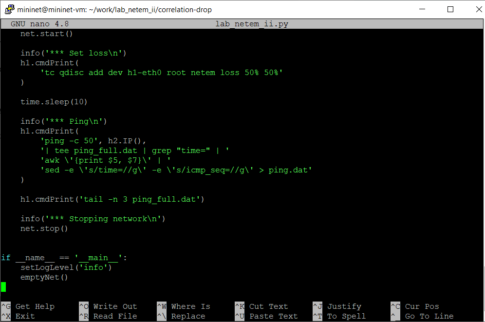{ #fig-015 width=70% }

Для управления воспроизводимым экспериментом `correlation-drop` создаю отдельный файл `Makefile`.

Структуру Makefile сохраняю аналогичной предыдущему эксперименту. Основная цель `all: ping.dat` обеспечивает формирование файла с результатами проверки соединения.

Команда `sudo python lab_netem_ii.py` запускает Python-скрипт с необходимыми системными привилегиями. После завершения программы команда `sudo chown mininet:mininet ping.dat` назначает пользователю `mininet` права владения созданным файлом.

Дополнительно сохраняю цель `clean`, позволяющую удалить результаты предыдущих запусков с помощью команды `-rm -f *.dat`.

Использование отдельного Makefile позволяет независимо запускать эксперимент с коррелированными потерями пакетов и поддерживать порядок в рабочем каталоге (см. рис. [@fig-016]).

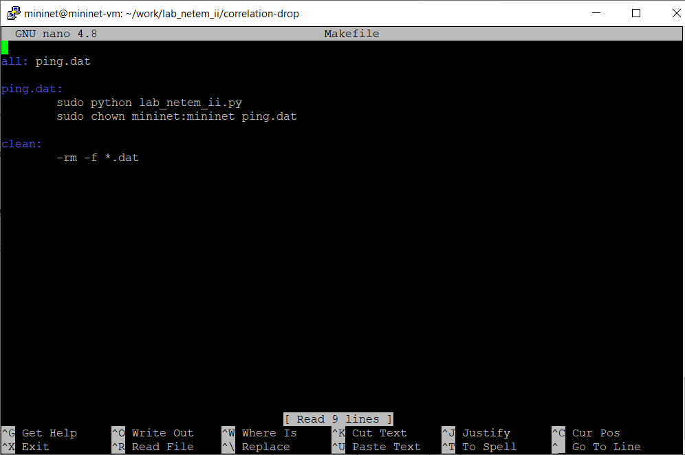{ #fig-016 width=70% }

После подготовки файлов запускаю воспроизводимый эксперимент с коррелированными потерями пакетов.

В процессе выполнения программа автоматически создаёт топологию Mininet, запускает контроллер и коммутатор, а затем устанавливает правило `tc qdisc add dev h1-eth0 root netem loss 50% 50%`.

После настройки ограничения запускается проверка соединения между хостами, включающая отправку `50` ICMP-запросов.

По итогам эксперимента получаю следующие показатели:

- отправлено пакетов — `50`;
- получено пакетов — `23`;
- потеряно пакетов — `27`;
- процент потерь — `54%`;
- минимальное RTT — `0.059 мс`;
- среднее RTT — `133.155 мс`;
- максимальное RTT — `2040.050 мс`;
- стандартное отклонение RTT — `456.336 мс`.

Измеренная доля потерь составляет `54%`, что близко к настроенному значению `50%`. Полученный результат также сопоставим с интерактивным экспериментом, в котором наблюдалось `56%` потерь.

Отдельно отмечаю увеличение среднего и максимального времени ответа. Значение максимального RTT достигает `2040.050 мс`, что указывает на наличие отдельных ответов с существенно увеличенным временем ожидания.

После завершения проверки скрипт останавливает контроллер, коммутатор и оба виртуальных хоста. В выводе отображается сообщение `*** Done`, подтверждающее окончание работы программы.

Результаты показывают, что автоматизированный сценарий позволяет воспроизвести высокую вероятность потери пакетов с заданной корреляцией и получить сводную статистику без ручного управления каждым этапом (см. рис. [@fig-017]).

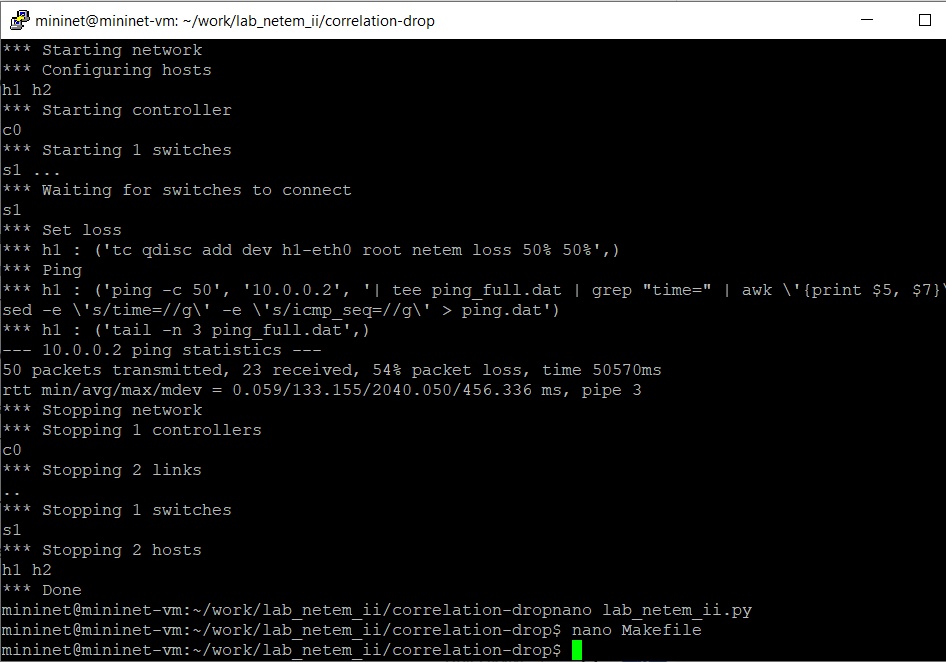{ #fig-017 width=70% }

Следующим этапом реализую воспроизводимый эксперимент по исследованию изменения порядка передачи пакетов. Для этого создаю рабочий каталог `~/work/lab_netem_ii/reorder` и подготавливаю Python-скрипт `lab_netem_ii.py`.

В скрипте использую ранее реализованную последовательность создания сетевой топологии Mininet с контроллером `c0`, хостами `h1` и `h2`, а также коммутатором `s1`.

После запуска сети добавляю правило `tc qdisc add dev h1-eth0 root netem delay 10ms reorder 25% 50%` через метод `h1.cmdPrint()`.

Данное правило позволяет моделировать изменение порядка отправки пакетов при установленной задержке `10 мс`, вероятности переупорядочивания `25%` и корреляции `50%`.

После настройки NETEM выполняю паузу продолжительностью `10` секунд, а затем запускаю проверку соединения командой `ping -c 20` по IP-адресу второго хоста.

Для сохранения результатов использую файлы `ping_full.dat` и `ping.dat`. Первый файл содержит полный вывод проверки, а второй предназначен для хранения выделенных значений номеров последовательности и времени ответа.

В конце скрипта отображаю сводную статистику с помощью `tail -n 3 ping_full.dat` и останавливаю сеть методом `net.stop()`.

Автоматизация позволяет выполнять эксперимент с заданными параметрами задержки и переупорядочивания без необходимости вручную повторять команды настройки интерфейсов (см. рис. [@fig-018]).

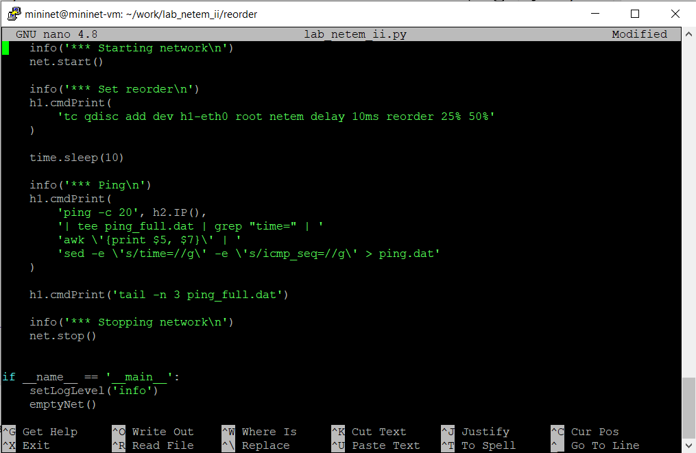{ #fig-018 width=70% }

Для запуска эксперимента `reorder` создаю в соответствующем каталоге файл `Makefile`.

В качестве основной цели задаю `all: ping.dat`, которая обеспечивает запуск сценария и формирование файла с результатами измерения.

Для выполнения Python-скрипта использую команду `sudo python lab_netem_ii.py`. После создания результирующего файла выполняется изменение его владельца командой `sudo chown mininet:mininet ping.dat`.

Дополнительно добавляю цель `clean`, содержащую команду `-rm -f *.dat`, которая предназначена для удаления сохранённых результатов.

Структура Makefile соответствует использованной в предыдущих экспериментах, что обеспечивает единообразный способ управления всеми воспроизводимыми сценариями (см. рис. [@fig-019]).

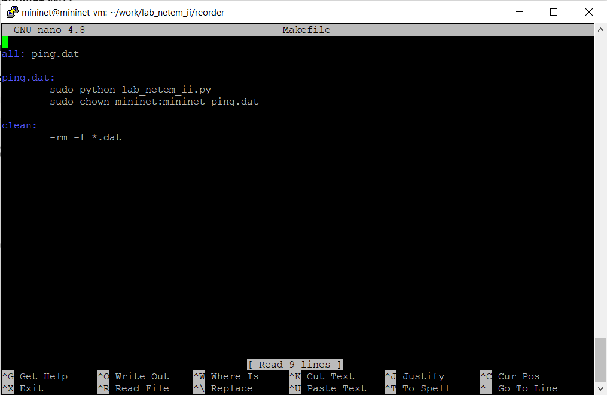{ #fig-019 width=70% }

После подготовки Python-скрипта и Makefile запускаю воспроизводимый эксперимент по исследованию изменения порядка передачи пакетов.

Программа создаёт виртуальную сеть, устанавливает соединения между хостами и коммутатором, запускает контроллер, после чего применяет к интерфейсу `h1-eth0` правило NETEM с задержкой `10 мс` и параметром `reorder 25% 50%`.

Затем выполняется проверка соединения с отправкой `20` ICMP-запросов.

По итогам выполнения эксперимента получаю следующие результаты:

- отправлено пакетов — `20`;
- получено пакетов — `20`;
- процент потерь — `0%`;
- минимальное RTT — `0.066 мс`;
- среднее RTT — `13.627 мс`;
- максимальное RTT — `49.586 мс`;
- стандартное отклонение RTT — `9.566 мс`.

В результате все пакеты успешно достигают получателя, однако время их передачи существенно различается.

Среднее RTT составляет `13.627 мс`, что значительно превышает исходное среднее время `0.385 мс`, полученное до применения NETEM. Максимальное время ответа достигает `49.586 мс`.

По сравнению с интерактивным экспериментом, в котором среднее RTT составляло `9.497 мс`, наблюдаю увеличение среднего времени ответа и разброса измерений.

Полученные значения подтверждают воздействие правила NETEM на временные характеристики передачи пакетов. При этом отсутствие потерь показывает, что заданное переупорядочивание не требует обязательного отбрасывания пакетов.

После завершения измерений скрипт автоматически останавливает виртуальную сеть и освобождает созданные ресурсы (см. рис. [@fig-020]).

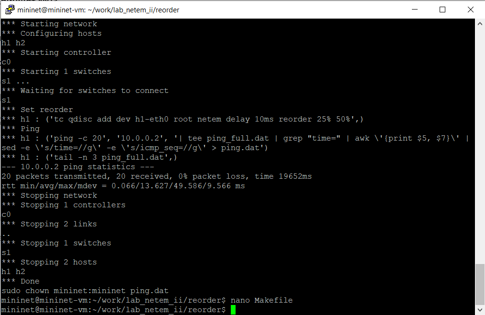{ #fig-020 width=70% }

На завершающем этапе реализую воспроизводимый эксперимент по исследованию повреждения пакетов. Для этого создаю каталог `~/work/lab_netem_ii/corrupt` и подготавливаю Python-скрипт `lab_netem_ii.py`.

В данном эксперименте использую ранее рассмотренный механизм NETEM `corrupt 0.01%`, предназначенный для эмуляции повреждения передаваемых пакетов. В отличие от экспериментов с командой `ping`, для измерения влияния повреждений на транспортный протокол применяю инструмент `iPerf3`.

После создания и запуска виртуальной сети предусматриваю временную паузу `time.sleep(10)`.

Далее на хосте `h2` запускаю сервер iPerf3 с помощью метода `h2.popen()` и команды `iperf3 -s`. Использование `popen()` позволяет запустить серверный процесс без блокирования дальнейшего выполнения Python-скрипта.

Для перенаправления стандартного вывода и сообщений об ошибках серверного процесса использую `subprocess.DEVNULL`.

После запуска сервера выполняю дополнительную паузу `time.sleep(1)`, необходимую для подготовки сервера к приёму входящих соединений.

Затем на хосте `h1` выполняю команду `iperf3 -c 10.0.0.2 | tee iperf3.dat`. Она запускает клиент iPerf3 и одновременно сохраняет результаты измерения в файл `iperf3.dat`.

После завершения передачи данных вызываю методы `server.terminate()` и `server.wait()`, обеспечивающие остановку серверного процесса и ожидание его завершения.

В конце скрипта использую `net.stop()` для удаления виртуальных сетевых устройств и завершения работы Mininet.

Подготовленная программа позволяет автоматически выполнять измерение производительности TCP при наличии искусственных повреждений пакетов (см. рис. [@fig-021]).

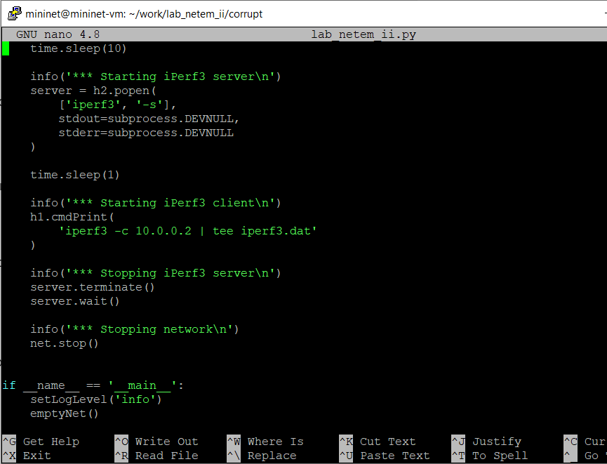{ #fig-021 width=70% }

Для управления воспроизводимым экспериментом `corrupt` создаю отдельный Makefile.

В отличие от предыдущих экспериментов, основным результирующим файлом выступает `iperf3.dat`, содержащий сведения о передаче данных, пропускной способности и повторных передачах TCP.

Поэтому в Makefile задаю основную цель `all: iperf3.dat`, а для формирования файла использую команду `sudo python lab_netem_ii.py`.

После завершения эксперимента выполняется команда `sudo chown mininet:mininet iperf3.dat`, изменяющая владельца результирующего файла.

Для удаления результатов предыдущих запусков предусматриваю цель `clean`, использующую команду `-rm -f *.dat`.

Созданный Makefile позволяет запускать эксперимент командой `make`, сохраняя результаты измерений в отдельном файле и обеспечивая возможность их дальнейшего анализа (см. рис. [@fig-022]).

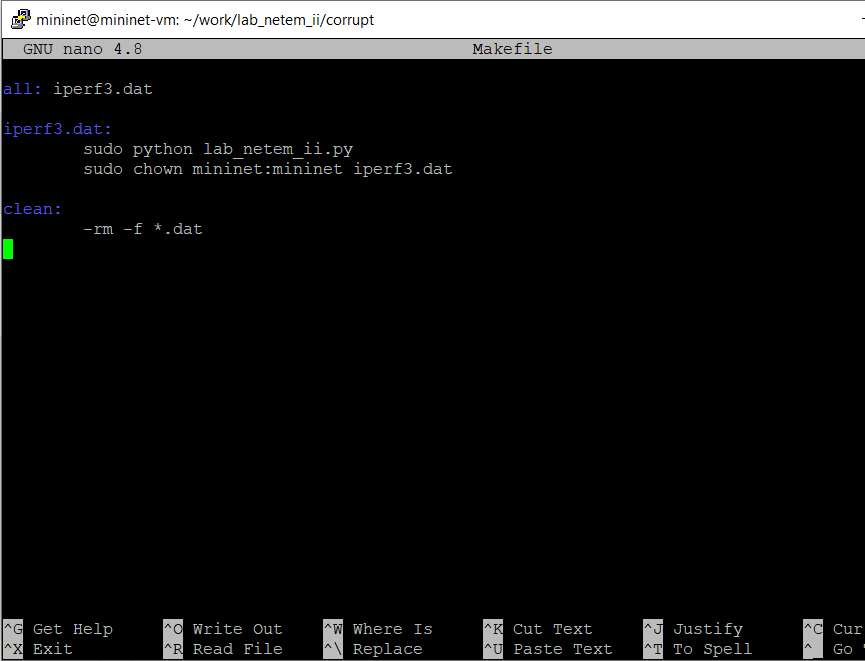{ #fig-022 width=70% }

После подготовки файлов запускаю воспроизводимый эксперимент по исследованию повреждения пакетов.

Во время выполнения программы создаётся виртуальная сеть Mininet, запускается контроллер, добавляются два хоста и коммутатор. Далее запускается сервер iPerf3 на хосте `h2`, после чего клиент на хосте `h1` устанавливает TCP-соединение с адресом `10.0.0.2` через порт `5201`.

В ходе измерения iPerf3 выполняет передачу данных продолжительностью `10` секунд. Для анализа использую столбцы `Transfer`, `Bitrate`, `Retr` и `Cwnd`.

Параметр `Transfer` показывает количество переданных данных, `Bitrate` — скорость передачи, `Retr` — количество повторных передач TCP-сегментов, а `Cwnd` — размер окна перегрузки TCP.

В результате получаю следующие значения повторных передач по временным интервалам:

- `0–1 с` — `2` повторные передачи;
- `1–2 с` — `186`;
- `2–3 с` — `6`;
- `3–4 с` — `5`;
- `4–5 с` — `3`;
- `5–6 с` — `5`;
- `6–7 с` — `6`;
- `7–8 с` — `9`;
- `8–9 с` — `4`;
- `9–10 с` — `2`.

Суммарное количество повторных передач составляет `228`. Наибольшее количество повторных передач наблюдается на интервале `1–2 с`, где зафиксировано `186` повторных отправок TCP-сегментов.

За время измерения передано `20.0 GBytes` данных, а средняя пропускная способность составляет `17.2 Gbit/s`.

По сравнению с интерактивным экспериментом, в котором было зафиксировано `55` повторных передач при средней скорости `18.7 Gbit/s`, количество повторных передач увеличивается до `228`, а средняя скорость снижается до `17.2 Gbit/s`.

Полученные результаты показывают, что при наличии ошибок передачи TCP может выполнять значительное количество повторных отправок сегментов. При этом конкретное число повторных передач зависит от условий эксперимента, состояния TCP-соединения и вероятностного характера воздействия NETEM.

После завершения измерения iPerf3 выводит итоговую статистику, затем Python-скрипт останавливает сервер и виртуальную сеть. В консоли появляется сообщение `*** Done`, после чего выполняется изменение владельца файла `iperf3.dat`.

Успешное завершение программы подтверждает работоспособность автоматизированного сценария исследования повреждения пакетов (см. рис. [@fig-023]).

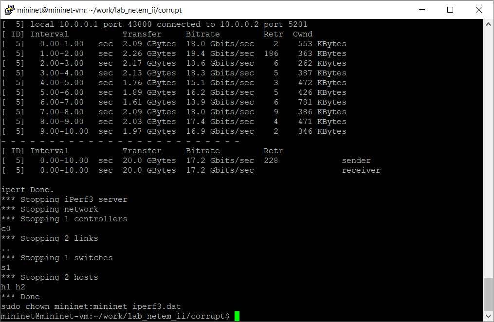{ #fig-023 width=70% }

# Вывод

В ходе лабораторной работы изучены возможности NETEM для эмуляции потерь, повреждения, дублирования и переупорядочивания пакетов в среде Mininet. Проведены эксперименты по настройке вероятности потерь, корреляции, повреждения и изменения порядка передачи пакетов. С помощью API Mininet, Python и Makefile автоматизированы сетевые эксперименты, измерения RTT и сбор статистики потерь. Инструмент iPerf3 использован для анализа пропускной способности и повторных передач TCP-сегментов. Полученные результаты подтвердили влияние параметров NETEM на надёжность передачи данных, количество потерянных пакетов и производительность сетевого соединения.

# Список литературы

1. [Mininet. Официальная документация по созданию и эмуляции сетевых топологий](https://mininet.org/walkthrough/).

2. [Linux Manual Pages. tc-netem(8) — эмуляция потерь, задержек, повреждения, дублирования и переупорядочивания сетевых пакетов](https://man7.org/linux/man-pages/man8/tc-netem.8.html).

3. [ESnet. iPerf3 — документация по измерению пропускной способности и производительности сетевых соединений](https://software.es.net/iperf/).

4. [GNU Project. GNU Make Manual — руководство по автоматизации выполнения программ и экспериментов с помощью Makefile](https://www.gnu.org/software/make/manual/).